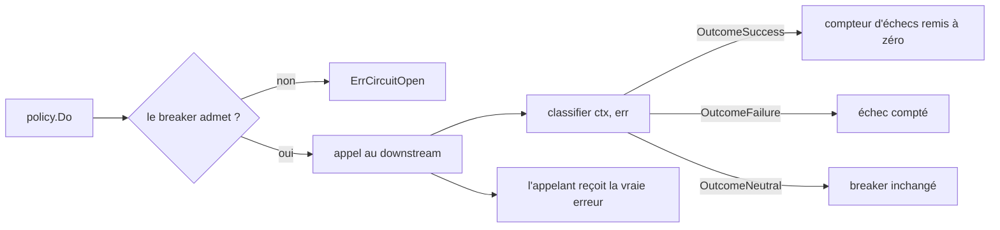

*[Read in English](README.md)*

# Exemple 44 — Classifier du circuit breaker

Montre `CircuitBreakerClassifier`, qui indique au circuit breaker quels appels
renseignent sur la santé du downstream. L'appelant, lui, reçoit toujours la
vraie erreur.

## Ce que cet exemple illustre

Par défaut, le breaker compte toute erreur non nil comme un échec et toute
erreur nil comme un succès. Deux sortes d'appels échappent à cette règle :

- une réponse métier comme « commande introuvable » est une erreur pour
  l'appelant, mais elle prouve que le downstream répond ;
- un appel abandonné par son appelant (deadline dépassée, arrêt du service) ne
  prouve rien, ni dans un sens ni dans l'autre.

Compter le premier ouvre le breaker sur un service en bonne santé. Compter le
second comme un échec rouvre un breaker en cours de rétablissement. Le compter
comme un succès remet le compteur d'échecs à zéro, et un downstream bloqué
n'ouvre alors jamais le breaker.

Le classifier range chaque appel dans `OutcomeSuccess`, `OutcomeFailure` ou
`OutcomeNeutral`. Un appel neutre ne touche ni au compteur d'échecs ni à la
fenêtre des appels lents. En half-open, il libère la sonde sans rien compter.
L'exemple déroule trois phases contre un breaker qui s'ouvre après deux échecs :

1. **Réponses métier** : trois erreurs « commande introuvable ». Le classifier
   les rend neutres, et le breaker reste fermé.
2. **Appelants qui abandonnent** : deux appelants avec une deadline de 50 ms
   appellent un downstream qui met 200 ms. `CallerCancellationIsNeutral` rend
   les deux appels neutres, et le breaker reste fermé.
3. **Downstream bloqué** : le timeout de la policy (300 ms) coupe deux appels.
   Une deadline posée par r8e n'est jamais une annulation de l'appelant : les
   deux appels comptent comme des échecs, le breaker s'ouvre et le troisième
   appel échoue tout de suite avec `ErrCircuitOpen`.

## Fonctionnement



## Concepts clés

| Concept | Détail |
|---|---|
| `CircuitBreakerClassifier(fn)` | Définit comment le middleware de la policy transforme `(ctx, err)` en `Outcome`. Nil rétablit le défaut |
| `OutcomeSuccess` / `OutcomeFailure` | Ce que renvoie le classifier par défaut pour une erreur nil / non nil |
| `OutcomeNeutral` | L'appel ne dit rien du downstream : rien n'est compté, et une sonde half-open est libérée |
| `IsCallerCancellation(ctx, err)` | Vrai quand le contexte de l'appelant a mis fin à l'appel, cause comprise ; faux pour une deadline posée par r8e (`WithTimeout`, `PerAttemptTimeout` d'un retry, budget `PropagateDeadline` qui tombe avant la deadline de l'appelant) |
| `CallerCancellationIsNeutral` | Classifier prêt à l'emploi : l'annulation par l'appelant est neutre, le reste est classé comme par défaut |
| `CircuitBreaker.Acquire` / `CircuitPermit.Done` | L'API autonome derrière le middleware ; un résultat antérieur à la dernière ouverture du breaker est ignoré |

## Quand l'utiliser

- Avec un downstream qui renvoie des erreurs métier (introuvable, requête
  invalide, conflit) qui ne doivent pas ouvrir le breaker.
- Avec des appelants dont la deadline est plus courte que le timeout de la
  policy, ou des services qui annulent les appels en cours à l'arrêt.
- Pour détecter un downstream bloqué alors que les appelants abandonnent avant,
  gardez un `WithTimeout` plus court que leurs deadlines : le timeout de la
  policy compte toujours comme un échec.

## Exécution

```bash
go run ./examples/44-circuit-breaker-classifier/
```

## Sortie attendue

```text
=== Phase 1: "not found" answers do not count ===
  call 1: order not found (state=closed)
  call 2: order not found (state=closed)
  call 3: order not found (state=closed)

=== Phase 2: callers that give up do not count ===
  call 1: context deadline exceeded (state=closed)
  call 2: context deadline exceeded (state=closed)

=== Phase 3: a hanging downstream still opens the breaker ===
  call 1: timeout (state=closed)
  [hook] circuit OPENED
  call 2: timeout (state=open)
  call 3: circuit breaker is open (state=open)
```
