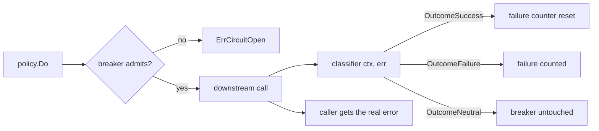

*[Lire en Français](README.fr.md)*

# Example 44 — Circuit Breaker Classifier

Demonstrates `CircuitBreakerClassifier`: it tells the circuit breaker which calls
say something about the downstream's health, while callers keep receiving the
real error.

## What it demonstrates

By default the breaker counts every non-nil error as a failure and every nil
error as a success. Three kinds of call don't fit that rule:

- a business answer such as "order not found" is an error for the caller, but
  it proves the downstream is up;
- a call whose caller gave up (its deadline passed, the service is shutting
  down) proves nothing either way;
- a call the policy's own bulkhead or rate limiter turned away never reached
  the downstream: these guards run inside the breaker, which sees their
  rejections.

Counting the first or the third opens the breaker on a healthy service.
Counting the second as a failure reopens a recovering breaker. Reporting it as
a success resets the failure counter, so a hanging downstream never trips the
breaker.

The classifier maps each call to `OutcomeSuccess`, `OutcomeFailure` or
`OutcomeNeutral`. A neutral call leaves the failure counter and the slow-call
window untouched; in half-open it frees the probe slot without counting. The
example runs four phases against breakers that open after two failures:

1. **Business answers** — three "order not found" errors. The classifier marks
   them neutral, and the breaker stays closed.
2. **Callers that give up** — two callers with a 50ms deadline call a downstream
   that needs 200ms. `CallerCancellationIsNeutral` marks both calls neutral, and
   the breaker stays closed.
3. **Burst past the bulkhead** — on a second policy with a one-slot bulkhead,
   one call holds the slot while two more arrive. The bulkhead turns them away
   with `ErrBulkheadFull`; `IsLocalRejection` makes those rejections neutral,
   and the breaker stays closed.
4. **Hanging downstream** — the policy's own 300ms timeout cuts two calls. A
   deadline set by r8e is never a caller cancellation, so both count as
   failures: the breaker opens and the third call fails fast with
   `ErrCircuitOpen`.

## How it works



## Key concepts

| Concept | Detail |
|---|---|
| `CircuitBreakerClassifier(fn)` | Sets how the policy middleware turns `(ctx, err)` into an `Outcome`. Nil restores the default |
| `OutcomeSuccess` / `OutcomeFailure` | What the default classifier returns for a nil / non-nil error |
| `OutcomeNeutral` | The call says nothing about the downstream: no count, and a half-open probe slot is freed |
| `IsCallerCancellation(ctx, err)` | True when the caller's context ended the call, cause included; false for a deadline r8e set (`WithTimeout`, a retry `PerAttemptTimeout`, a `PropagateDeadline` budget ending before the caller's deadline) |
| `CallerCancellationIsNeutral` | Ready-made classifier: caller cancellation is neutral, the rest is classified as by default |
| `IsLocalRejection(err)` | True when `err` is itself, not wrapped, one of `ErrRateLimited`, `ErrBulkheadFull`, `ErrBulkheadTimeout`, `ErrCoDelShed`, `ErrConcurrencyLimited`: what a guard inside the breaker returns. A function that returns one of them itself matches too, so wrap it there |
| `CircuitBreaker.Acquire` / `CircuitPermit.Done` | The standalone API behind the middleware; an outcome from before the breaker last opened is ignored |

## When to use

- Downstreams that answer with business errors (not found, invalid request,
  conflict) that should not open the breaker.
- Callers with deadlines shorter than the policy timeout, or services that
  cancel in-flight calls on shutdown.
- Policies with a bulkhead, a rate limiter or adaptive concurrency next to the
  breaker: a burst they shed should not open it.
- To catch a hanging downstream when callers give up first, keep `WithTimeout`
  shorter than the callers' deadlines: the policy timeout always counts as a
  failure.

## Run

```bash
go run ./examples/44-circuit-breaker-classifier/
```

## Expected output

```text
=== Phase 1: "not found" answers do not count ===
  call 1: order not found (state=closed)
  call 2: order not found (state=closed)
  call 3: order not found (state=closed)

=== Phase 2: callers that give up do not count ===
  call 1: context deadline exceeded (state=closed)
  call 2: context deadline exceeded (state=closed)

=== Phase 3: a burst past the bulkhead does not count ===
  call 1: bulkhead full (state=closed)
  call 2: bulkhead full (state=closed)
  the call holding the slot: order 7 (state=closed)

=== Phase 4: a hanging downstream still opens the breaker ===
  call 1: timeout (state=closed)
  [hook] circuit OPENED
  call 2: timeout (state=open)
  call 3: circuit breaker is open (state=open)
```
