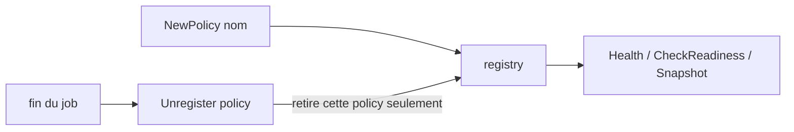

*[Read in English](README.md)*

# Exemple 45 — Retirer une policy du registry

Montre `Registry.Unregister`, qui retire une policy nommée du registry où elle
s'est inscrite. Le registry ne rend alors compte que des policies encore
utilisées.

## Ce que cet exemple illustre

Une policy nommée s'inscrit dans `DefaultRegistry`, ou dans le registry passé
avec `WithRegistry`, et le registry la garde jusqu'à ce qu'on la retire. Un
service qui crée une policy nommée par job, par tenant ou par test ferait
grossir son registry sans limite, et ses endpoints de health et de readiness
continueraient d'afficher des policies qui ne tournent plus.

L'exemple déroule trois phases :

1. **Une policy par job** : chaque job crée une policy à son nom et la retire
   avec un `defer` à la fin. Pendant le job, le registry l'affiche ; ensuite, il
   est de nouveau vide.
2. **Retrait par identité** : deux policies portent le nom `tenant-api`. Retirer
   la première n'enlève qu'elle ; la retirer une deuxième fois renvoie `false` ;
   la seconde part quand on la retire à son tour.
3. **Le registry rejoint par la policy** : une policy créée avec `WithRegistry`
   n'est pas dans `DefaultRegistry`, donc l'y retirer renvoie `false` ;
   `policy.Registry().Unregister(policy)` la retire. Une policy sans nom n'a
   rejoint aucun registry : `Registry()` vaut nil, et `Unregister` sur nil
   renvoie `false`.

## Fonctionnement



## Concepts clés

| Concept | Détail |
|---|---|
| `NewPolicy(nom, ...)` | Une policy nommée s'inscrit dans `DefaultRegistry`, ou dans le registry donné par `WithRegistry` |
| `Registry.Unregister(hr)` | Retire toutes les inscriptions de `hr`, comparé par identité, et indique s'il y en avait ; sur un registry nil, renvoie `false` |
| `Policy.Registry()` | Le registry que la policy a rejoint (`DefaultRegistry` ou celui de `WithRegistry`), nil pour une policy sans nom : `defer policy.Registry().Unregister(policy)` marche dans tous les cas |
| Même nom, autre policy | Pas touchée : un nom peut revenir, une identité non |
| Lecteurs concurrents | `Health`, `CheckReadiness` et `Snapshot` continuent sur la liste avec laquelle ils ont commencé |

## Quand l'utiliser

- Avec des policies nommées créées par job, par requête, par tenant ou par test.
- Pour des endpoints de health qui ne doivent lister que les policies encore
  utilisées.
- Autres solutions : un nom vide (la policy ne s'inscrit jamais), ou un registry
  qu'on jette avec ses policies.

## Exécution

```bash
go run ./examples/45-registry-unregister/
```

## Sortie attendue

```text
=== Phase 1: one policy per job, removed when the job ends ===
  job 1 done (registered while running: [job-1])
  after job 1: 0 registered
  job 2 done (registered while running: [job-2])
  after job 2: 0 registered
  job 3 done (registered while running: [job-3])
  after job 3: 0 registered

=== Phase 2: removal is by identity, not by name ===
  registered: [tenant-api tenant-api]
  unregister the first: true
  registered: [tenant-api]
  unregister the first again: false
  unregister the second: true
  registered: []

=== Phase 3: the policy knows the registry it joined ===
  unregister from DefaultRegistry: false
  unregister from its own registry: true
  unnamed policy, no registry: true
  unregister the unnamed policy: false
```
