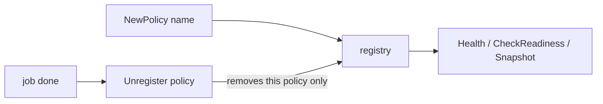

*[Lire en Français](README.fr.md)*

# Example 45 — Registry Unregister

Demonstrates `Registry.Unregister`: it takes a named policy out of the registry
it joined, so the registry only reports on the policies that are still in use.

## What it demonstrates

A named policy registers itself with `DefaultRegistry` (or the registry passed
with `WithRegistry`), and the registry keeps it until something removes it. A
service that builds a named policy per job, per tenant or per test would
otherwise grow its registry without bound, and its health and readiness
endpoints would keep listing policies that no longer run.

The example runs three phases:

1. **One policy per job** — each job builds a policy named after it and
   unregisters it with `defer` when the job returns. While a job runs, the
   registry lists it; afterwards the registry is empty again.
2. **Removal by identity** — two policies share the name `tenant-api`.
   Unregistering the first removes only that one; unregistering it again
   reports `false`; the second goes when it is unregistered in turn.
3. **The registry a policy joined** — a policy built with `WithRegistry` is
   not in `DefaultRegistry`, so unregistering it there reports `false`;
   `policy.Registry().Unregister(policy)` removes it. An unnamed policy joined
   no registry: `Registry()` is nil, and `Unregister` on nil reports `false`.

## How it works



## Key concepts

| Concept | Detail |
|---|---|
| `NewPolicy(name, ...)` | A named policy registers with `DefaultRegistry`, or with the registry given by `WithRegistry` |
| `Registry.Unregister(hr)` | Removes every registration of `hr`, compared by identity, and reports whether there was any; on a nil registry it returns `false` |
| `Policy.Registry()` | The registry the policy joined (`DefaultRegistry` or the `WithRegistry` one), nil for an unnamed policy: `defer policy.Registry().Unregister(policy)` works in every case |
| Same name, other policy | Not affected: names may repeat, identity may not |
| Concurrent readers | `Health`, `CheckReadiness` and `Snapshot` keep iterating the list they started with |

## When to use

- Policies built per job, per request, per tenant or per test, with a name.
- Health endpoints that should list only the policies still in use.
- Alternatives: an empty name (the policy never registers), or a registry you
  drop together with its policies.

## Run

```bash
go run ./examples/45-registry-unregister/
```

## Expected output

```text
=== Phase 1: one policy per job, removed when the job ends ===
  job 1 done (registered while running: [job-1])
  after job 1: 0 registered
  job 2 done (registered while running: [job-2])
  after job 2: 0 registered
  job 3 done (registered while running: [job-3])
  after job 3: 0 registered

=== Phase 2: removal is by identity, not by name ===
  registered: [tenant-api tenant-api]
  unregister the first: true
  registered: [tenant-api]
  unregister the first again: false
  unregister the second: true
  registered: []

=== Phase 3: the policy knows the registry it joined ===
  unregister from DefaultRegistry: false
  unregister from its own registry: true
  unnamed policy, no registry: true
  unregister the unnamed policy: false
```
