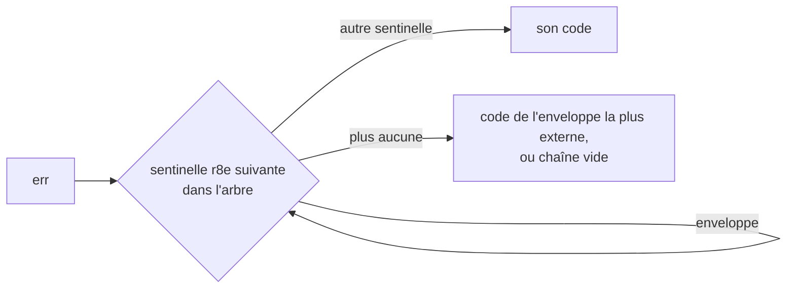

*[Read in English](README.md)*

# Exemple 46 — Codes d'erreur

Montre `r8e.ErrorCode`, qui renvoie le code court et stable de la sentinelle
r8e portée par une erreur. Ce code sert de champ de log, de label de métrique
ou d'attribut de trace.

## Ce qu'il démontre

Le message d'une erreur fait un mauvais label. Il change à chaque wrap et peut
contenir des données de la requête : une métrique qui l'utilise comme label
grossit sans limite. `errors.Is`, lui, ne teste qu'une sentinelle à la fois.

`ErrorCode(err)` parcourt l'arbre de l'erreur comme `errors.As`, de
l'extérieur vers l'intérieur. Il renvoie le code de la première sentinelle r8e
qui n'est pas une enveloppe. Trois sentinelles sont des enveloppes :
`ErrRetriesExhausted`, `ErrTimeBudgetExceeded` et
`ErrConcurrencyBudgetExceeded`. Elles enveloppent l'erreur de la dernière
tentative et laissent donc la place à la cause qu'elles portent. Une erreur qui
ne porte que des enveloppes donne le code de la plus externe. Une erreur sans
sentinelle r8e, nil compris, donne `""`.

L'exemple affiche le code de cinq erreurs :

1. **Erreur simple** : le downstream renvoie `payments unavailable`. Elle ne
   porte aucune sentinelle r8e, le code vaut donc `""`.
2. **Breaker ouvert** : cet échec a ouvert le breaker, qui refuse l'appel
   suivant avec `ErrCircuitOpen`. Le code vaut `circuit_open`.
3. **Erreur enveloppée par l'appelant** : `fmt.Errorf("checkout: %w", err)`
   garde le code `circuit_open`.
4. **Retries épuisés sur un timeout** : une policy cliente relance les appels
   à une policy interne, dont le `WithTimeout` coupe chaque appel. L'erreur
   vaut `retries exhausted: timeout` et le code est celui de la cause,
   `timeout`. Il faut deux policies : dans une seule policy, `WithTimeout`
   tourne à l'extérieur du retry, et `ErrRetriesExhausted` n'enveloppe donc
   jamais son `ErrTimeout`.
5. **Retries épuisés sur une erreur simple** : la cause n'a pas de code, et
   l'enveloppe donne le seul code, `retries_exhausted`.

L'exemple compte ensuite les erreurs par code, comme le ferait une métrique
avec un label `reason`. Il donne au code `""` un label à part, `other`.

## Fonctionnement



## Concepts clés

| Concept | Détail |
|---|---|
| `ErrorCode(err)` | Le code de la première sentinelle r8e hors enveloppe dans l'arbre de `err`, en partant de l'extérieur ; `""` quand `err` ne porte aucune sentinelle r8e, nil compris |
| Enveloppes | `ErrRetriesExhausted`, `ErrTimeBudgetExceeded` et `ErrConcurrencyBudgetExceeded` laissent la place à la cause qu'elles enveloppent. Sans autre sentinelle, l'enveloppe la plus externe donne le code |
| `ErrAttemptTimeout` | N'est pas une enveloppe : son code est `attempt_timeout` ([exemple 49](../49-attempt-timeout)) |
| `Unwrap` seulement | `ErrorCode` atteint une sentinelle par `Unwrap`, jamais par une méthode `Is`. Un type d'erreur à vous qui ne correspond à une sentinelle que par `Is` n'a pas de code : enveloppez la sentinelle avec `%w` |
| Label borné | Les codes forment un ensemble fixe, on peut donc s'en servir comme label de métrique |

## Quand l'utiliser

- Pour un champ `reason` dans des logs structurés :
  `slog.Warn("call failed", "reason", r8e.ErrorCode(err), "err", err)`.
- Pour un label sur un compteur d'échecs, ou un attribut sur un span de trace.
- Remplacez `""` par un label à vous, comme `other`, si chaque échec doit
  avoir un label non vide.

## Lancer

```bash
go run ./examples/46-error-codes/
```

## Sortie attendue

```text
=== ErrorCode for five errors ===
  1. plain error from the downstream
    err="payments unavailable"
    code=""
  2. call rejected by the open breaker
    err="circuit breaker is open"
    code="circuit_open"
  3. the same rejection, wrapped by the caller
    err="checkout: circuit breaker is open"
    code="circuit_open"
  4. retries exhausted around a timeout
    err="retries exhausted: timeout"
    code="timeout"
  5. retries exhausted around a plain error
    err="retries exhausted: connection reset"
    code="retries_exhausted"

=== Failures by reason label ===
  reason=circuit_open count=2
  reason=other count=1
  reason=retries_exhausted count=1
  reason=timeout count=1
```
