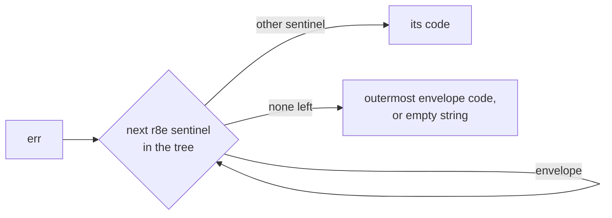

*[Lire en Français](README.fr.md)*

# Example 46 — Error Codes

Demonstrates `r8e.ErrorCode`: it returns the short, stable code of the r8e
sentinel an error carries, for logs, metrics and trace labels.

## What it demonstrates

An error message makes a poor label for a log field or a metric. It changes
with every wrap and can carry request data, so a metric labelled with it grows
without bound. `errors.Is` tests one sentinel at a time.

`ErrorCode(err)` walks the error tree as `errors.As` does, outermost first, and
returns the code of the first r8e sentinel that is not an envelope. Three
sentinels are envelopes: `ErrRetriesExhausted`, `ErrTimeBudgetExceeded` and
`ErrConcurrencyBudgetExceeded`. They wrap the error that ended the last
attempt, so they yield to the cause they carry. An error that carries only
envelopes reports the outermost one. An error with no r8e sentinel, nil
included, reports `""`.

The example prints the code of five errors:

1. **Plain error**: the downstream returns `payments unavailable`. It carries
   no r8e sentinel, so the code is `""`.
2. **Open breaker**: that failure opened the breaker, which rejects the next
   call with `ErrCircuitOpen`. The code is `circuit_open`.
3. **Wrapped by the caller**: `fmt.Errorf("checkout: %w", err)` keeps the code,
   `circuit_open`.
4. **Retries exhausted around a timeout**: a client policy retries calls to an
   inner policy whose `WithTimeout` cuts each one. The error reads
   `retries exhausted: timeout`, and the code is the cause, `timeout`. Two
   policies are needed: within one policy, `WithTimeout` runs outside the
   retry, so `ErrRetriesExhausted` never wraps its `ErrTimeout`.
5. **Retries exhausted around a plain error**: the cause has no code, so the
   envelope is the only one, `retries_exhausted`.

It then counts the errors by code, as a metric with a `reason` label would. The
example gives the `""` code a label of its own, `other`.

## How it works



## Key concepts

| Concept | Detail |
|---|---|
| `ErrorCode(err)` | The code of the first non-envelope r8e sentinel in the tree of `err`, outermost first; `""` when `err` carries no r8e sentinel, nil included |
| Envelopes | `ErrRetriesExhausted`, `ErrTimeBudgetExceeded`, `ErrConcurrencyBudgetExceeded` yield to the cause they wrap. With no other sentinel, the outermost envelope gives the code |
| `ErrAttemptTimeout` | Not an envelope: it reports `attempt_timeout` ([example 49](../49-attempt-timeout)) |
| `Unwrap` only | `ErrorCode` reaches a sentinel through `Unwrap`, never through an `Is` method. An error type of your own that matches a sentinel only through `Is` carries no code: wrap the sentinel with `%w` |
| Bounded label | The codes form a fixed set, so they are safe as a metric label |

## When to use

- A `reason` field in structured logs:
  `slog.Warn("call failed", "reason", r8e.ErrorCode(err), "err", err)`.
- A label on a failure counter, or an attribute on a trace span.
- Map `""` to a label of your own, such as `other`, when you want every
  failure to have a non-empty label.

## Run

```bash
go run ./examples/46-error-codes/
```

## Expected output

```text
=== ErrorCode for five errors ===
  1. plain error from the downstream
    err="payments unavailable"
    code=""
  2. call rejected by the open breaker
    err="circuit breaker is open"
    code="circuit_open"
  3. the same rejection, wrapped by the caller
    err="checkout: circuit breaker is open"
    code="circuit_open"
  4. retries exhausted around a timeout
    err="retries exhausted: timeout"
    code="timeout"
  5. retries exhausted around a plain error
    err="retries exhausted: connection reset"
    code="retries_exhausted"

=== Failures by reason label ===
  reason=circuit_open count=2
  reason=other count=1
  reason=retries_exhausted count=1
  reason=timeout count=1
```
