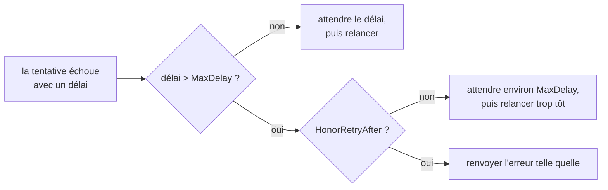

*[Read in English](README.md)*

# Exemple 48 — Respecter le Retry-After

Montre `HonorRetryAfter` : quand le serveur demande d'attendre plus longtemps
que `MaxDelay`, le retry s'arrête au lieu de repartir trop tôt.

## Ce qu'il démontre

Le retry respecte un `Retry-After` porté par une erreur (`RetryAfterProvider`)
à la place du backoff ([exemple 23](../23-retry-after)). Par défaut, `MaxDelay`
plafonne ce délai, puis un jitter l'allonge de 10 % au plus. Face à un quota,
le retry part alors trop tôt, et le serveur le refuse de nouveau.

`HonorRetryAfter()` change ce comportement. Quand le délai brut, avant jitter,
dépasse `MaxDelay`, le retry s'arrête. `Do` renvoie la dernière erreur telle
quelle, sans l'envelopper dans `ErrRetriesExhausted`. L'appelant lit donc le
délai complet via `RetryAfterProvider` et peut replanifier le travail. L'échec
compte quand même dans un retry budget. Un délai inférieur ou égal à
`MaxDelay` est attendu comme d'habitude.

Le downstream répond avec `r8e.RetryAfterError(errQuota, hint)`, enveloppé
dans une erreur `fetch report:`. Chaque policy fait au plus 3 tentatives avec
`MaxDelay(50ms)`. L'exemple déroule trois phases :

1. **Par défaut** : le délai d'une heure est ramené à environ 50 ms. Les trois
   tentatives tombent sur le quota, et l'appel finit au bout d'au moins
   100 ms avec `retries exhausted: fetch report: quota exceeded`.
2. **`HonorRetryAfter`, délai au-dessus de `MaxDelay`** : l'appel s'arrête
   après la première tentative. L'erreur est celle du downstream,
   `errors.Is(err, r8e.ErrRetriesExhausted)` vaut false, et `errors.As`
   retrouve le délai d'une heure.
3. **`HonorRetryAfter`, délai sous `MaxDelay`** : le retry attend le délai de
   20 ms, et la deuxième tentative réussit.

## Fonctionnement



## Concepts clés

| Concept | Détail |
|---|---|
| `RetryAfterProvider` | Interface `RetryAfter() (time.Duration, bool)` d'une erreur qui porte un délai fourni par le serveur. Le `StatusError` de l'adaptateur `httpx` l'implémente à partir du header HTTP |
| `RetryAfterError(err, d)` | Attache un délai fixe à n'importe quelle erreur. L'erreur garde sa classification : elle est relancée sauf si elle est `Permanent` |
| `MaxDelay(d)` | Plafonne le backoff et le délai du serveur. Un délai plafonné attend entre `d` et 1,1 × `d` |
| `HonorRetryAfter()` | Un délai brut au-dessus de `MaxDelay` arrête le retry, à chaque tentative, la dernière comprise. L'erreur revient telle quelle, jamais enveloppée dans `ErrRetriesExhausted` |
| Sans `MaxDelay` | Le retry attend chaque délai : `HonorRetryAfter` n'a alors aucun effet |
| Retry budget | L'échec qui arrête le retry compte quand même |
| Config | `honor_retry_after` dans le bloc `retry` |

## Quand l'utiliser

- Avec une API à quota strict qui répond 429 avec un long `Retry-After`.
- Dans un batch ou un worker de file qui peut remettre le travail en file et
  le relancer à l'heure donnée par le serveur.
- Chaque fois que l'appelant préfère récupérer le délai plutôt que gaspiller
  un retry que le serveur va refuser.

## Lancer

```bash
go run ./examples/48-honor-retry-after/
```

## Sortie attendue

```text
=== Phase 1: default, the hint is capped by MaxDelay ===
  attempts=3 err="retries exhausted: fetch report: quota exceeded"
  waited at least 2 x MaxDelay: true
  errors.Is(err, ErrRetriesExhausted)=true

=== Phase 2: HonorRetryAfter, a hint above MaxDelay stops the retry ===
  attempts=1 err="fetch report: quota exceeded"
  errors.Is(err, ErrRetriesExhausted)=false
  the caller reads the hint: retry after 1h0m0s

=== Phase 3: HonorRetryAfter, a hint below MaxDelay is waited ===
  attempts=2 result="report ready" err=<nil>
  waited at least the hint: true
```
