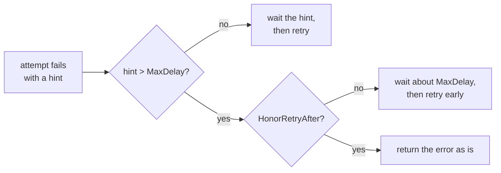

*[Lire en Français](README.fr.md)*

# Example 48 — Honor Retry-After

Demonstrates `HonorRetryAfter`: a server hint longer than `MaxDelay` stops the
retry, instead of a retry sent before the time the server asked for.

## What it demonstrates

Retry honors a `Retry-After` hint carried by an error (`RetryAfterProvider`) in
place of the backoff ([example 23](../23-retry-after)). By default the hint is
capped by `MaxDelay`, then spread upward by up to 10%. Against a quota, a
capped hint makes the retry leave early, and the server rejects it again.

`HonorRetryAfter()` changes that. When the raw hint, before jitter, exceeds
`MaxDelay`, the retry stops. `Do` returns the last error as is: it is not
wrapped with `ErrRetriesExhausted`, so the caller reads the full hint through
`RetryAfterProvider` and can schedule the work for later. The failure still
counts against a retry budget. A hint at or below `MaxDelay` is waited as
usual.

The downstream answers with `r8e.RetryAfterError(errQuota, hint)`, wrapped in a
`fetch report:` error. Each policy makes up to 3 attempts with
`MaxDelay(50ms)`. The example runs three phases:

1. **Default**: the one-hour hint is capped to about 50ms. All three attempts
   meet the quota, and after at least 100ms the call ends with
   `retries exhausted: fetch report: quota exceeded`.
2. **`HonorRetryAfter`, hint above `MaxDelay`**: the call stops after the first
   attempt. The error is the downstream's own,
   `errors.Is(err, r8e.ErrRetriesExhausted)` is false, and `errors.As` finds
   the one-hour hint.
3. **`HonorRetryAfter`, hint below `MaxDelay`**: a 20ms hint is waited, and the
   second attempt succeeds.

## How it works



## Key concepts

| Concept | Detail |
|---|---|
| `RetryAfterProvider` | Interface `RetryAfter() (time.Duration, bool)` of an error that carries a server delay. The `httpx` adapter's `StatusError` implements it from the HTTP header |
| `RetryAfterError(err, d)` | Attaches a fixed hint to any error. The error keeps its own classification: it is retried unless it is `Permanent` |
| `MaxDelay(d)` | Caps the backoff and the hint. A capped hint waits between `d` and 1.1 × `d` |
| `HonorRetryAfter()` | A raw hint above `MaxDelay` ends the retry, on every attempt, the last one included. The error comes back as is, never wrapped with `ErrRetriesExhausted` |
| Without `MaxDelay` | Every hint is waited, so `HonorRetryAfter` has no effect |
| Retry budget | The failure that stops the retry still counts against it |
| Config | `honor_retry_after` in the `retry` block |

## When to use

- APIs with a hard quota that answer 429 with a long `Retry-After`.
- Batch jobs or queue workers that can put the work back and run it at the
  time the server gave.
- Any caller that would rather get the hint back than spend a retry that the
  server will reject.

## Run

```bash
go run ./examples/48-honor-retry-after/
```

## Expected output

```text
=== Phase 1: default, the hint is capped by MaxDelay ===
  attempts=3 err="retries exhausted: fetch report: quota exceeded"
  waited at least 2 x MaxDelay: true
  errors.Is(err, ErrRetriesExhausted)=true

=== Phase 2: HonorRetryAfter, a hint above MaxDelay stops the retry ===
  attempts=1 err="fetch report: quota exceeded"
  errors.Is(err, ErrRetriesExhausted)=false
  the caller reads the hint: retry after 1h0m0s

=== Phase 3: HonorRetryAfter, a hint below MaxDelay is waited ===
  attempts=2 result="report ready" err=<nil>
  waited at least the hint: true
```
