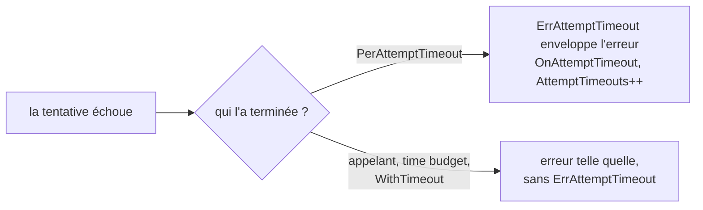

*[Read in English](README.md)*

# Exemple 49 — Timeout par tentative

Montre `PerAttemptTimeout` avec `ErrAttemptTimeout`, le hook
`OnAttemptTimeout` et la métrique `AttemptTimeouts`. Une tentative lente est
coupée pour laisser la suivante partir, et l'appelant distingue cette coupure
de sa propre deadline.

## Ce qu'il démontre

`PerAttemptTimeout(d)` donne à chaque tentative du retry sa propre deadline.
Une tentative bloquée est coupée au bout de `d`, et le retry passe à la
suivante. Cette coupure et la deadline de l'appelant terminent toutes les deux
la tentative avec `context.DeadlineExceeded`. Cette erreur seule ne dit donc
pas qui a mis fin à la tentative.

Quand la deadline par tentative coupe une tentative en échec, r8e :

- enveloppe l'erreur de la tentative dans `ErrAttemptTimeout`, et garde cette
  erreur dans la chaîne ;
- appelle `Hooks.OnAttemptTimeout(attempt)`, avec un numéro de tentative qui
  commence à 1 ;
- compte la coupure dans `Metrics().AttemptTimeouts`.

Une tentative terminée par la deadline ou l'annulation de l'appelant, par un
time budget ou par `WithTimeout` ne porte pas `ErrAttemptTimeout`. La deadline
par tentative ne s'applique que si elle tombe avant celles-ci.

Une seule policy (3 tentatives, `PerAttemptTimeout(50ms)`) déroule trois
phases face à un downstream qui bloque jusqu'à la fin de son contexte :

1. **Deux tentatives coupées, puis une rapide** : le hook se déclenche pour
   les tentatives 1 et 2, et la tentative 3 répond. `AttemptTimeouts` vaut 2.
2. **Toutes les tentatives coupées** : l'erreur vaut
   `retries exhausted: attempt timeout: read response: context deadline exceeded`.
   `errors.Is(err, r8e.ErrAttemptTimeout)` est vrai, et `ErrorCode` renvoie
   `attempt_timeout`. `errors.Is(err, context.DeadlineExceeded)` est vrai
   aussi, parce que le downstream enveloppe l'erreur de son contexte : r8e
   n'ajoute rien à la chaîne. `AttemptTimeouts` vaut 5.
3. **La deadline de l'appelant d'abord** : l'appelant accorde 30 ms, moins que
   la deadline par tentative. Le retry s'arrête sur le contexte terminé et
   renvoie `context deadline exceeded`, sans `ErrAttemptTimeout`. Aucun hook
   ne se déclenche, et `AttemptTimeouts` reste à 5.

## Fonctionnement



## Concepts clés

| Concept | Détail |
|---|---|
| `PerAttemptTimeout(d)` | Deadline de chaque tentative. Elle ne s'applique que si elle tombe avant la deadline de l'appelant et avant toute deadline r8e englobante. Code uniquement : `RetryConfig` n'a pas de champ pour elle |
| `ErrAttemptTimeout` | Enveloppe l'erreur d'une tentative coupée. L'erreur de la tentative reste dans la chaîne, et rien n'y est ajouté |
| `OnAttemptTimeout(attempt int)` | Se déclenche pour chaque tentative coupée, numérotée à partir de 1 comme pour `OnRetry` |
| `AttemptTimeouts` | Compteur de `PolicyMetrics` des tentatives coupées |
| `ErrorCode` | Renvoie `attempt_timeout`. `ErrAttemptTimeout` n'est pas une enveloppe |
| Deadline de l'appelant | Termine la tentative sans `ErrAttemptTimeout`, comme un time budget ou `WithTimeout` |
| `Permanent`, `RetryIf` | Une tentative coupée marquée `Permanent`, ou refusée par `RetryIf`, est enveloppée aussi et arrête quand même le retry |

## Quand l'utiliser

- Avec un downstream qui bloque parfois, quand une nouvelle tentative a de
  bonnes chances de répondre.
- Pour des logs, des alertes ou des métriques qui doivent séparer « le
  downstream était trop lent » de « l'appelant a abandonné ».
- Gardez les tentatives, leur deadline et le backoff dans la deadline de
  l'appelant. Sinon, les dernières tentatives se terminent sur la deadline de
  l'appelant.

## Lancer

```bash
go run ./examples/49-attempt-timeout/
```

## Sortie attendue

```text
=== Phase 1: slow attempts are cut, the next one succeeds ===
  [hook] attempt 1 cut by PerAttemptTimeout
  [hook] attempt 2 cut by PerAttemptTimeout
  result="answer on attempt 3" err=<nil>
  AttemptTimeouts=2

=== Phase 2: every attempt is cut ===
  [hook] attempt 1 cut by PerAttemptTimeout
  [hook] attempt 2 cut by PerAttemptTimeout
  [hook] attempt 3 cut by PerAttemptTimeout
  err="retries exhausted: attempt timeout: read response: context deadline exceeded"
  errors.Is(err, r8e.ErrAttemptTimeout)=true
  errors.Is(err, context.DeadlineExceeded)=true
  r8e.ErrorCode(err)="attempt_timeout"
  AttemptTimeouts=5

=== Phase 3: the caller's own deadline ends the attempt ===
  err="context deadline exceeded"
  errors.Is(err, r8e.ErrAttemptTimeout)=false
  errors.Is(err, context.DeadlineExceeded)=true
  r8e.ErrorCode(err)=""
  AttemptTimeouts=5
```
