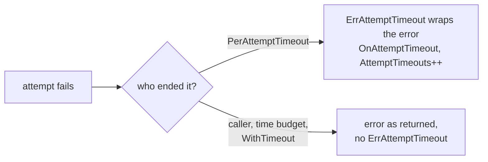

*[Lire en Français](README.fr.md)*

# Example 49 — Per-Attempt Timeout

Demonstrates `PerAttemptTimeout` with `ErrAttemptTimeout`, the
`OnAttemptTimeout` hook and the `AttemptTimeouts` metric. A slow attempt is cut
so the next one can run, and the caller can tell that cut apart from its own
deadline.

## What it demonstrates

`PerAttemptTimeout(d)` gives each retry attempt its own deadline. A stuck
attempt is cut after `d`, and the retry moves on. Both this cut and the
caller's deadline end the attempt with `context.DeadlineExceeded`, so that
error alone does not say who ended it.

When the per-attempt deadline cuts a failed attempt, r8e:

- wraps the attempt's error with `ErrAttemptTimeout`, and keeps that error in
  the chain;
- fires `Hooks.OnAttemptTimeout(attempt)`, with a 1-indexed attempt number;
- counts the cut in `Metrics().AttemptTimeouts`.

An attempt ended by the caller's deadline or cancellation, a time budget or
`WithTimeout` carries no `ErrAttemptTimeout`. The per-attempt deadline binds
only when it is earlier than those.

One policy (3 attempts, `PerAttemptTimeout(50ms)`) runs three phases against a
downstream that hangs until its context ends:

1. **Two cut attempts, then a fast one**: the hook fires for attempts 1 and 2,
   and attempt 3 answers. `AttemptTimeouts` is 2.
2. **Every attempt cut**: the error reads
   `retries exhausted: attempt timeout: read response: context deadline exceeded`.
   `errors.Is(err, r8e.ErrAttemptTimeout)` holds, and `ErrorCode` reports
   `attempt_timeout`. `errors.Is(err, context.DeadlineExceeded)` holds too,
   because the downstream wraps its context's error: r8e adds nothing to the
   chain. `AttemptTimeouts` is 5.
3. **The caller's deadline first**: the caller allows 30ms, less than the
   attempt deadline. The retry stops on the ended context and returns
   `context deadline exceeded`, without `ErrAttemptTimeout`. No hook fires,
   and `AttemptTimeouts` stays at 5.

## How it works



## Key concepts

| Concept | Detail |
|---|---|
| `PerAttemptTimeout(d)` | Deadline for each attempt. It binds only when it is earlier than the caller's deadline and any enclosing r8e deadline. Code-only: `RetryConfig` has no field for it |
| `ErrAttemptTimeout` | Wraps the error of a cut attempt. The attempt's own error stays in the chain, and nothing is added to it |
| `OnAttemptTimeout(attempt int)` | Fires for each cut attempt, 1-indexed like `OnRetry` |
| `AttemptTimeouts` | `PolicyMetrics` counter of the cut attempts |
| `ErrorCode` | Reports `attempt_timeout`. `ErrAttemptTimeout` is not an envelope |
| Caller's deadline | Ends the attempt without `ErrAttemptTimeout`, like a time budget or `WithTimeout` |
| `Permanent`, `RetryIf` | A cut attempt marked `Permanent`, or rejected by `RetryIf`, is wrapped too and still stops the retry |

## When to use

- A downstream that sometimes hangs, when a fresh attempt is likely to answer.
- Logs, alerts or metrics that must tell "the downstream was too slow" apart
  from "the caller gave up".
- Keep the attempts, their per-attempt deadline and the backoff within the
  caller's deadline, or the last attempts end on the caller's deadline instead.

## Run

```bash
go run ./examples/49-attempt-timeout/
```

## Expected output

```text
=== Phase 1: slow attempts are cut, the next one succeeds ===
  [hook] attempt 1 cut by PerAttemptTimeout
  [hook] attempt 2 cut by PerAttemptTimeout
  result="answer on attempt 3" err=<nil>
  AttemptTimeouts=2

=== Phase 2: every attempt is cut ===
  [hook] attempt 1 cut by PerAttemptTimeout
  [hook] attempt 2 cut by PerAttemptTimeout
  [hook] attempt 3 cut by PerAttemptTimeout
  err="retries exhausted: attempt timeout: read response: context deadline exceeded"
  errors.Is(err, r8e.ErrAttemptTimeout)=true
  errors.Is(err, context.DeadlineExceeded)=true
  r8e.ErrorCode(err)="attempt_timeout"
  AttemptTimeouts=5

=== Phase 3: the caller's own deadline ends the attempt ===
  err="context deadline exceeded"
  errors.Is(err, r8e.ErrAttemptTimeout)=false
  errors.Is(err, context.DeadlineExceeded)=true
  r8e.ErrorCode(err)=""
  AttemptTimeouts=5
```
