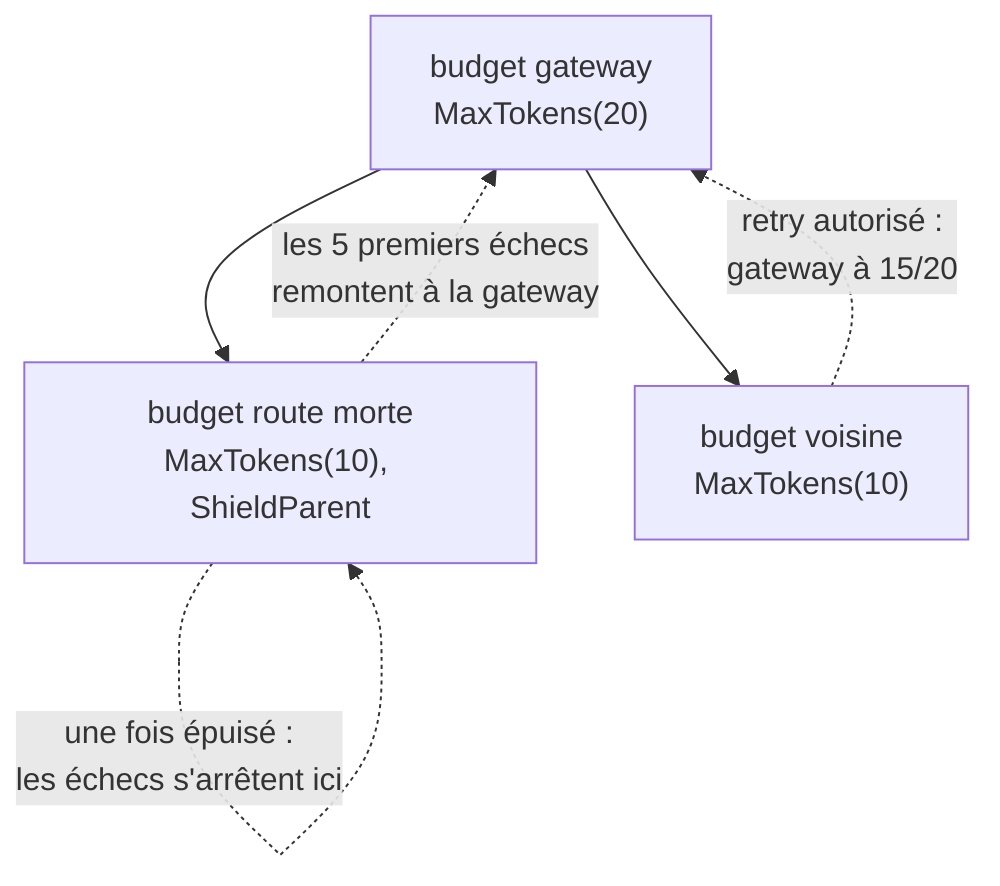

*[Read in English](README.md)*

# Exemple 50 — Protéger le retry budget parent

Montre `ShieldParent` : une route morte arrête de vider le retry budget
qu'elle partage avec ses voisines, et celles-ci gardent leurs retries.

## Ce qu'il démontre

Dans un arbre de budgets ([exemple 42](../42-nested-retry-budget)), chaque
échec d'un enfant est aussi débité de son parent. Quand une route est morte,
son propre budget coupe ses retries. Mais chaque nouvel appel fait encore une
première tentative, et chaque première tentative en échec vide encore le
parent. Le parent partagé finit vide, et les routes voisines en bonne santé
perdent leurs retries.

`ShieldParent()` sur l'enfant borne cette perte. Tant que l'enfant est épuisé
(à la moitié de sa capacité ou en dessous), ses échecs ne remontent plus au
parent. Ils remontent de nouveau dès que des succès ramènent l'enfant
au-dessus de ce seuil. Une route morte vide alors le parent d'au plus la
moitié de sa propre capacité, arrondie au supérieur : 5 tokens pour
`MaxTokens(10)`. Les voisines gardent leurs retries tant que le parent reste
au-dessus de la moitié de sa capacité après cette perte. Dimensionnez le
parent en conséquence.

L'exemple construit deux fois le même arbre : un budget de gateway de
20 tokens, avec deux budgets de route de 10 tokens en dessous. Chaque policy
de route fait au plus 3 tentatives. La première route échoue sur 20 appels de
suite : 3 tentatives pour le premier appel, 2 pour le deuxième (son budget
atteint alors la moitié), puis 1 pour chacun des 18 autres, soit 23 en tout.
La deuxième route fait ensuite un appel qui échoue une fois puis répond au
retry.

- **Sans `ShieldParent`** : les 23 tentatives en échec vident la gateway
  jusqu'à 0. Le budget de la voisine est plein, mais la gateway refuse son
  retry. L'appel fait une seule tentative et échoue avec `transient blip`.
- **Avec `ShieldParent` sur la route morte** : la route morte fait toujours
  23 tentatives, mais la gateway ne perd que les 5 tokens qui amènent la
  route morte à la moitié de sa capacité. Elle reste à 15/20, au-dessus de sa
  moitié : la voisine relance et obtient sa réponse.

## Fonctionnement



## Concepts clés

| Concept | Détail |
|---|---|
| `ShieldParent()` | Option de `NewRetryBudget`. Tant que cet enfant est épuisé, ses échecs ne remontent pas à son parent |
| Borne | Une route morte vide le parent d'au plus la moitié de sa propre capacité, arrondie au supérieur, tant que sa capacité ne change pas pendant ce temps |
| Dimensionnement | Les voisines gardent leurs retries tant que le parent reste au-dessus de la moitié de sa capacité après cette perte : ici 20 − 5 = 15, au-dessus de 10 |
| Succès | Toujours crédités au parent, même quand le shield est actif. Aucune borne n'est garantie pour un enfant instable : chaque succès qui le remet au-dessus du seuil laisse passer l'échec suivant |
| Supervision | Quand le shield est actif, les tokens du parent ne comptent pas les échecs de cet enfant : surveillez le budget de l'enfant lui-même (`Exhausted()`, `Tokens()`) |
| Budget intermédiaire | Sur un budget intermédiaire, le shield empêche les échecs de tout son sous-arbre de remonter aux ancêtres au-dessus de lui |
| Code uniquement | Fixé à la construction, comme `Parent`. `Reconfigure` ne l'ajoute ni ne le retire, et il n'a aucun effet sur un budget sans parent |

## Quand l'utiliser

- Avec un budget de gateway partagé par des routes qui peuvent tomber
  séparément, par exemple un backend mort parmi plusieurs.
- Dimensionnez le parent pour la perte de toutes les routes protégées qui
  peuvent tomber en même temps, afin qu'il reste au-dessus de la moitié de sa
  capacité.

## Lancer

```bash
go run ./examples/50-shield-parent/
```

## Sortie attendue

```text
=== Without ShieldParent ===
  dead route: 20 calls failed, 23 attempts
  budgets: gateway=0.0/20 dead=0.0/10 sibling=10.0/10
  gateway.Exhausted()=true
  sibling route: attempts=1 result="" err=transient blip

=== With ShieldParent on the dead route ===
  dead route: 20 calls failed, 23 attempts
  budgets: gateway=15.0/20 dead=0.0/10 sibling=10.0/10
  gateway.Exhausted()=false
  sibling route: attempts=2 result="sibling answered" err=<nil>
```
