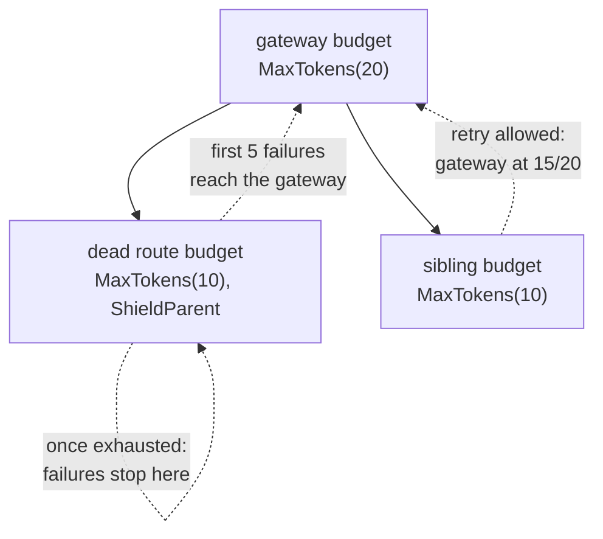

*[Lire en Français](README.fr.md)*

# Example 50 — Shield the Parent Retry Budget

Demonstrates `ShieldParent`: a dead route stops draining the retry budget it
shares with its siblings, so they keep their retries.

## What it demonstrates

In a budget tree ([example 42](../42-nested-retry-budget)), every failure of a
child is also debited from its parent. Once a route is dead, its own budget
cuts its retries, but each new call still makes a first attempt, and each
failed first attempt still drains the parent. The shared parent ends up empty,
and the healthy siblings lose their retries.

`ShieldParent()` on the child bounds that drain. While the child is exhausted
(at or below half its capacity), its failures are no longer passed to the
parent. They are again once successes bring the child back above that
threshold. A dead child then drains the parent by at most half of its own
capacity, rounded up: 5 tokens for `MaxTokens(10)`. The siblings keep their
retries as long as the parent stays above half its own capacity after that
drain, so size the parent for it.

The example builds the same tree twice: a gateway budget of 20 tokens, with two
route budgets of 10 under it. Each route policy makes up to 3 attempts. The
first route fails 20 calls in a row: 3 attempts for the first call, 2 for the
second (its budget then reaches half), and 1 for each of the 18 others, 23 in
all. The second route then makes one call that fails once and answers on the
retry.

- **Without `ShieldParent`**: the 23 failed attempts drain the gateway to 0.
  The sibling's own budget is full, but the gateway refuses its retry. The call
  makes one attempt and fails with `transient blip`.
- **With `ShieldParent` on the dead route**: the dead route still makes 23
  attempts, but the gateway loses only the 5 tokens that bring the dead route
  down to half its capacity. It stays at 15/20, above its half, so the sibling
  retries and gets its answer.

## How it works



## Key concepts

| Concept | Detail |
|---|---|
| `ShieldParent()` | Option of `NewRetryBudget`. While this child is exhausted, its failures are not passed to its parent |
| Bound | A dead child drains the parent by at most half of its own capacity, rounded up, as long as its capacity is not changed while it drains |
| Sizing | Siblings keep their retries while the parent stays above half its capacity after that drain: here 20 − 5 = 15, above 10 |
| Successes | Still credited to the parent while the shield holds. No bound is promised for a flapping child: each success that lifts it back above the threshold lets the next failure through |
| Monitoring | While the shield holds, the parent's tokens leave out that child's failures: watch the child's own budget (`Exhausted()`, `Tokens()`) |
| Middle budget | On a middle budget, the shield stops the failures of its whole subtree from reaching the ancestors above it |
| Code-only | Set at construction, like `Parent`. `Reconfigure` neither adds nor removes it, and it has no effect on a budget without a parent |

## When to use

- A gateway budget shared by routes that can fail on their own, such as one
  dead backend among several.
- Size the parent for the drain of every shielded child that can die at the
  same time, so it stays above half its capacity.

## Run

```bash
go run ./examples/50-shield-parent/
```

## Expected output

```text
=== Without ShieldParent ===
  dead route: 20 calls failed, 23 attempts
  budgets: gateway=0.0/20 dead=0.0/10 sibling=10.0/10
  gateway.Exhausted()=true
  sibling route: attempts=1 result="" err=transient blip

=== With ShieldParent on the dead route ===
  dead route: 20 calls failed, 23 attempts
  budgets: gateway=15.0/20 dead=0.0/10 sibling=10.0/10
  gateway.Exhausted()=false
  sibling route: attempts=2 result="sibling answered" err=<nil>
```
