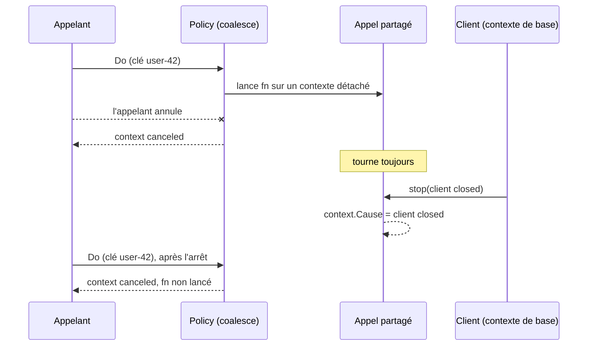

*[Read in English](README.md)*

# Exemple 51 — Arrêter les appels détachés

Montre `WithBaseContext` : quand le propriétaire d'une policy s'arrête, il peut
arrêter les appels que la policy fait tourner détachés de leurs appelants.

## Ce qu'il démontre

`WithCoalesce` fait tourner l'appel partagé sous un contexte détaché de tous
les appelants. Ainsi, un appelant qui part ne peut pas interrompre un travail
que les autres attendent. Le rechargement en avance (refresh-ahead) de
`WithCache` est détaché de la même façon. Plus rien en dehors de la policy ne
peut alors arrêter un tel appel : il tourne jusqu'au retour de `fn` ou jusqu'à
la coupure par `WithTimeout`, même après l'arrêt du client qui possède la
policy.

`WithBaseContext(ctx)` rattache ces appels détachés à un contexte que contrôle
le propriétaire. Annuler `ctx` les arrête, et leur contexte se termine avec la
cause de `ctx`. Ils gardent les valeurs du contexte de l'appelant et ignorent
toujours l'annulation propre à l'appelant.

L'exemple construit une policy avec `WithBaseContext`, `WithCoalesce` et un
`WithTimeout` d'une minute, puis déroule trois étapes :

- **Un appel coalescé survit à son appelant.** L'appel partagé démarre, lit
  l'ID de requête de l'appelant, puis attend la fin de son propre contexte.
  L'appelant annule : `Do` lui renvoie `context canceled`, et l'appel partagé
  continue de tourner (`CoalesceInFlight` vaut 1).
- **Le client s'arrête.** Le client annule le contexte de base avec la cause
  `client closed`. L'appel partagé s'arrête et lit cette cause avec
  `context.Cause`. `CoalesceInFlight` retombe à 0.
- **Appels après l'arrêt.** Un appel avec une clé de coalescing échoue tout de
  suite avec `context.Canceled`, avant que `fn` tourne, alors que le contexte
  de son appelant est toujours vivant. Un appel sans clé de coalescing n'est
  pas coalescé : il tourne sur le contexte de son appelant et obtient sa
  réponse.

## Fonctionnement



## Concepts clés

| Concept | Détail |
|---|---|
| `WithBaseContext(ctx)` | Rattache à `ctx` l'appel partagé de `WithCoalesce` et le rechargement en avance de `WithCache` |
| Cause | Un appel détaché arrêté par le contexte de base se termine avec la cause de `ctx`, qu'on lit avec `context.Cause` |
| Valeurs de l'appelant | Conservées : l'appel partagé lit toujours les valeurs du contexte de l'appelant |
| Annulation de l'appelant | Toujours ignorée : un appelant qui part reçoit l'erreur de son propre contexte, et l'appel partagé continue |
| Après la fin | Un appel avec une clé de coalescing qui rate le cache échoue tout de suite avec `context.Canceled`. Un hit du cache, une valeur périmée (`StaleIfError`) ou `WithFallback` lui répondent quand même |
| Sans clé | Un appel sans clé de coalescing tourne toujours sur le contexte de son appelant |
| Portée | Le contexte de base vaut pour tous ceux qui partagent la policy. Ne le posez que sur une policy dont tous les utilisateurs s'arrêtent avec son propriétaire |
| Code uniquement | Pas de clé de config, et `Reconfigure` ne le change pas. Un `ctx` nil est ignoré |

## Quand l'utiliser

- Pour un client qui possède ses policies et qui a une étape `Close` ou
  d'arrêt : annulez-y le contexte de base, et aucun appel coalescé ni
  rechargement ne survit au client.
- Pas sur une policy partagée avec du code qui continue de tourner après
  l'arrêt de ce propriétaire : une fois le contexte de base terminé, tout appel
  avec une clé qui rate le cache échoue.

## Lancer

```bash
go run ./examples/51-base-context/
```

## Sortie attendue

```text
=== A coalesced call outlives its caller ===
  shared call started, request ID: req-1
  caller left: context canceled
  shared calls still running: 1

=== The client shuts down ===
  shared call stopped, cause: client closed
  shared calls still running: 0

=== Calls after the shutdown ===
  with a key:    result="" err=context canceled canceled=true fn runs=0
  without a key: result="fresh answer" err=<nil> fn runs=1
```
