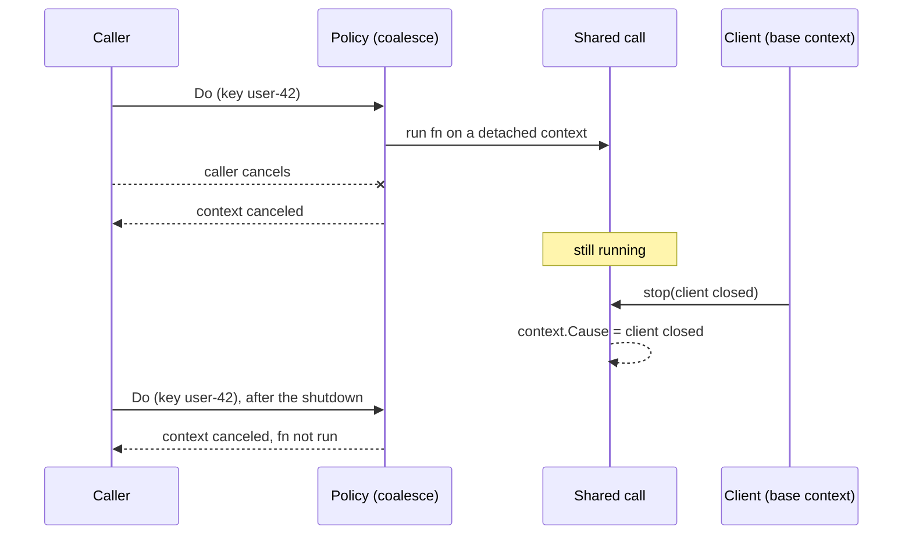

*[Lire en Français](README.fr.md)*

# Example 51 — Base Context for Detached Calls

Demonstrates `WithBaseContext`: the owner of a policy can stop the calls the
policy runs detached from their callers when it shuts down.

## What it demonstrates

`WithCoalesce` runs the shared call under a context detached from every
caller, so that one caller leaving cannot abort work the other callers wait
for. The refresh-ahead reload of `WithCache` is detached the same way. Nothing
outside the policy can then stop such a call: it runs until `fn` returns or
`WithTimeout` cuts it, even after the client that owns the policy has shut
down.

`WithBaseContext(ctx)` ties those detached calls to a context the owner
controls. Cancelling `ctx` stops them, and their context ends with `ctx`'s
cause. They keep the values of the caller's context and still ignore the
caller's own cancellation.

The example builds one policy with `WithBaseContext`, `WithCoalesce` and a
one-minute `WithTimeout`, then runs three steps:

- **A coalesced call outlives its caller.** The shared call starts, reads the
  caller's request ID, then waits for its own context to end. The caller
  cancels: `Do` returns `context canceled` to it, and the shared call keeps
  running (`CoalesceInFlight` is 1).
- **The client shuts down.** The client cancels the base context with the
  cause `client closed`. The shared call stops and reads that cause with
  `context.Cause`. `CoalesceInFlight` drops to 0.
- **Calls after the shutdown.** A call with a coalescing key fails at once
  with `context.Canceled`, before `fn` runs, even though its caller's context
  is live. A call with no coalescing key is not coalesced: it runs on its
  caller's context and gets its answer.

## How it works



## Key concepts

| Concept | Detail |
|---|---|
| `WithBaseContext(ctx)` | Ties the shared call of `WithCoalesce` and the refresh-ahead reload of `WithCache` to `ctx` |
| Cause | A detached call stopped by the base context ends with `ctx`'s cause, read with `context.Cause` |
| Caller values | Kept: the shared call still reads the values of the caller's context |
| Caller cancellation | Still ignored: a caller that leaves gets its own context error, and the shared call keeps running |
| After the end | A call with a coalescing key that misses the cache fails at once with `context.Canceled`. A cache hit, a stale value (`StaleIfError`) or `WithFallback` still answers it |
| No key | A call with no coalescing key still runs on its caller's context |
| Scope | The base context covers every holder of the policy. Set it only on a policy whose holders all stop with its owner |
| Code-only | No config key, and `Reconfigure` does not change it. A nil `ctx` is ignored |

## When to use

- A client that owns its policies and has a `Close` or shutdown step: cancel
  the base context there, so no coalesced call or reload outlives the client.
- Not on a policy shared with code that keeps running after that owner stops:
  once the base context has ended, every keyed call that misses the cache
  fails.

## Run

```bash
go run ./examples/51-base-context/
```

## Expected output

```text
=== A coalesced call outlives its caller ===
  shared call started, request ID: req-1
  caller left: context canceled
  shared calls still running: 1

=== The client shuts down ===
  shared call stopped, cause: client closed
  shared calls still running: 0

=== Calls after the shutdown ===
  with a key:    result="" err=context canceled canceled=true fn runs=0
  without a key: result="fresh answer" err=<nil> fn runs=1
```
