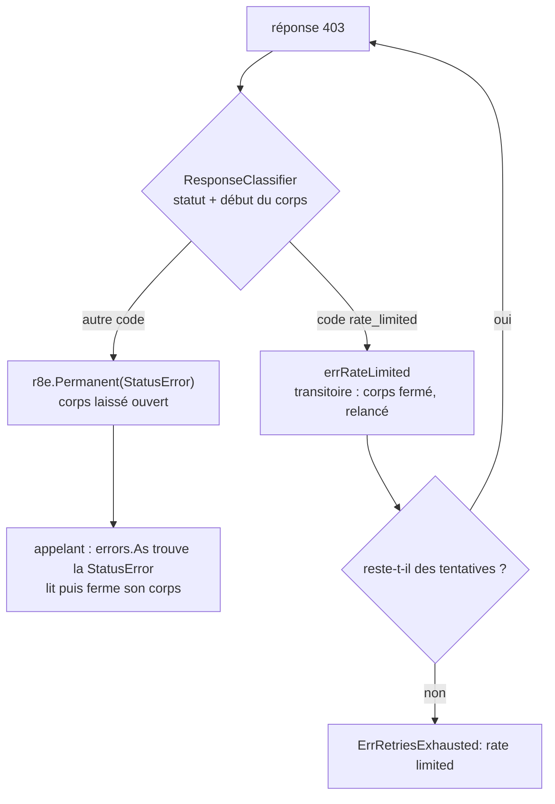

*[Read in English](README.md)*

# Exemple 52 — Classer une réponse d'après son corps

Montre `httpx.NewResponseClient` : son `ResponseClassifier` lit le début du
corps pour distinguer un 403 qu'on peut relancer d'un 403 définitif.

## Ce qu'il démontre

Certaines API renvoient le même statut pour deux cas opposés. Ici, un 403 avec
`{"code":"rate_limited"}` veut dire « réessayez », et un 403 avec
`{"code":"forbidden"}` veut dire « arrêtez ». Le `Classifier` de `NewClient` ne
voit que le code de statut : il doit relancer les deux cas, ou aucun.

Un `ResponseClassifier` reçoit la réponse et, pour un statut de 300 ou plus,
les `httpx.MaxClassifiedBody` premiers octets du corps. Il renvoie `nil` pour
un succès, une erreur transitoire pour relancer, ou `r8e.Permanent(err)` pour
arrêter. Le classifier de l'exemple renvoie :

- `nil` en dessous de 300 ;
- `errRateLimited`, une erreur transitoire, pour un 403 dont le corps contient
  `"code":"rate_limited"` ;
- `r8e.Permanent(&httpx.StatusError{Response: resp, StatusCode: resp.StatusCode})`
  pour tout autre statut de 300 ou plus.

La policy a `WithRetry(3, ...)`. Le serveur local a trois routes :

- **`/orders/1`** renvoie une fois un 403 rate limited, puis un 200. Le retry
  relance, et l'appelant reçoit le 200 et son corps.
- **`/orders/2`** renvoie un 403 forbidden. L'erreur permanente arrête le retry
  après une tentative. Sous `WithRetry`, `Do` renvoie une réponse `nil` :
  l'appelant trouve donc la `StatusError` avec `errors.As`, lit le corps depuis
  son premier octet et le ferme.
- **`/orders/3`** renvoie un 403 rate limited à chaque tentative. Après
  3 tentatives, l'erreur est `ErrRetriesExhausted`, qui enveloppe
  `errRateLimited`. L'adaptateur a fermé ce corps, et l'erreur ne porte pas de
  `StatusError`.

Chaque appel est borné par une deadline sur le contexte passé à `Do`, et non
par `r8e.WithTimeout`. `WithTimeout`, `WithHedge`, `PerAttemptTimeout` et
`WithTimeBudget` avec `PropagateDeadline` terminent le contexte de la tentative
quand ils rendent la main, et net/http coupe alors le corps : après `Do`,
l'appelant ne lirait que les octets déjà en tampon, puis recevrait
`context.Canceled`.

## Fonctionnement



## Concepts clés

| Concept | Détail |
|---|---|
| `NewResponseClient(name, hc, classify, opts...)` | Un `Client` qui classe chaque réponse avec un `ResponseClassifier` au lieu d'un `Classifier` |
| `ResponseClassifier` | `func(resp *http.Response, body []byte) error` : `nil` pour un succès, toute autre erreur est transitoire, `r8e.Permanent` arrête le retry |
| `body` | Les `MaxClassifiedBody` premiers octets (64 Kio) pour un statut de 300 ou plus, `nil` en dessous de 300. Pendant l'appel, `resp.Body` vaut `http.NoBody`. Ne modifiez pas `body` : l'appelant relit les mêmes octets |
| Pas de `StatusError` ajoutée | L'adaptateur n'ajoute rien à l'erreur du classifier. Renvoyez une `StatusError` pour `resp` pour retrouver la réponse avec `errors.As` et, sur une erreur transitoire, pour que son `Retry-After` soit respecté |
| Corps ouvert | Laissé ouvert sur `nil` et sur une erreur permanente qui porte une `StatusError` pour `resp`. Toute autre erreur le vide et le ferme |
| Réponse `nil` | Sous une policy qui relance, `Do` renvoie une réponse `nil` avec toute erreur : passez par la `StatusError` pour retrouver la réponse |
| Deadline sur `ctx` | Bornez l'appel par une deadline sur le contexte passé à `Do` pour lire tout le corps après `Do`. Les quatre options citées plus haut le coupent |
| Erreur enveloppée | La policy peut envelopper l'erreur (`ErrRetriesExhausted`) : comparez avec `errors.Is` ou `errors.As`, pas avec `==` |

## Quand l'utiliser

- Avec une API qui renvoie un même statut pour un cas qu'on peut relancer et
  pour un cas définitif, et qui précise lequel dans le corps.
- Gardez `NewClient` quand le code de statut suffit pour décider.

## Lancer

```bash
go run ./examples/52-response-classifier/
```

## Sortie attendue

```text
=== 403 rate_limited once, then 200 ===
  server: /orders/1 attempt 1
  server: /orders/1 attempt 2
  success: status=200 body={"id":1,"status":"shipped"}

=== 403 forbidden ===
  server: /orders/2 attempt 1
  error: http status 403 (resp is nil: true)
  rate limited: false, retries exhausted: false
  StatusError: status=403 body={"code":"forbidden","message":"order 2 belongs to another account"}

=== 403 rate_limited on every attempt ===
  server: /orders/3 attempt 1
  server: /orders/3 attempt 2
  server: /orders/3 attempt 3
  error: retries exhausted: rate limited (resp is nil: true)
  rate limited: true, retries exhausted: true
```
