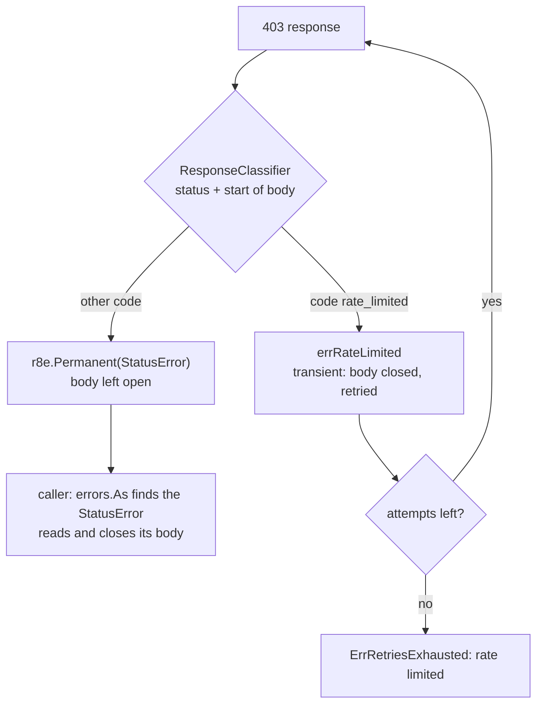

*[Lire en Français](README.fr.md)*

# Example 52 — Classify a Response from Its Body

Demonstrates `httpx.NewResponseClient`: its `ResponseClassifier` reads the
start of the body to tell a retriable 403 from a final one.

## What it demonstrates

Some APIs answer the same status for opposite cases. Here a 403 with
`{"code":"rate_limited"}` means "try again", and a 403 with
`{"code":"forbidden"}` means "stop". The `Classifier` of `NewClient` sees the
status code alone, so it must retry both cases or neither.

A `ResponseClassifier` receives the response and, for a status of 300 or
above, the first `httpx.MaxClassifiedBody` bytes of the body. It returns `nil`
for a success, a transient error to retry, or `r8e.Permanent(err)` to stop.
The classifier of this example returns:

- `nil` below 300;
- `errRateLimited`, a transient error, for a 403 whose body holds
  `"code":"rate_limited"`;
- `r8e.Permanent(&httpx.StatusError{Response: resp, StatusCode: resp.StatusCode})`
  for any other status of 300 or above.

The policy has `WithRetry(3, ...)`. The local server has three routes:

- **`/orders/1`** answers a rate-limited 403 once, then 200. The retry tries
  again and the caller gets the 200 and its body.
- **`/orders/2`** answers a forbidden 403. The permanent error stops the retry
  after one attempt. Under `WithRetry`, `Do` returns a `nil` response, so the
  caller finds the `StatusError` with `errors.As`, reads the body from its
  first byte and closes it.
- **`/orders/3`** answers a rate-limited 403 on every attempt. After 3 attempts
  the error is `ErrRetriesExhausted` wrapping `errRateLimited`. The adapter has
  closed that body, and the error carries no `StatusError`.

Each call is bounded by a deadline on the context passed to `Do`, not by
`r8e.WithTimeout`. `WithTimeout`, `WithHedge`, `PerAttemptTimeout` and
`WithTimeBudget` with `PropagateDeadline` end the attempt's context when they
return, and net/http then cuts the body: after `Do`, the caller could read only
the bytes already buffered, then get `context.Canceled`.

## How it works



## Key concepts

| Concept | Detail |
|---|---|
| `NewResponseClient(name, hc, classify, opts...)` | A `Client` that classifies each response with a `ResponseClassifier` instead of a `Classifier` |
| `ResponseClassifier` | `func(resp *http.Response, body []byte) error`: `nil` for a success, any other error is transient, `r8e.Permanent` stops the retry |
| `body` | The first `MaxClassifiedBody` bytes (64 KiB) for a status of 300 or above, `nil` below 300. During the call, `resp.Body` is `http.NoBody`. Do not modify `body`: the caller reads the same bytes back |
| No `StatusError` added | The adapter adds nothing to the classifier's error. Return a `StatusError` for `resp` to reach the response through `errors.As`, and, on a transient error, to have its `Retry-After` honored |
| Open body | Left open on `nil` and on a permanent error that carries a `StatusError` for `resp`. Any other error drains and closes it |
| `nil` response | Under a retrying policy, `Do` returns a `nil` response with any error: reach the response through the `StatusError` |
| Deadline on `ctx` | Bound the call with a deadline on the context passed to `Do` to read the whole body after `Do`. The four options above cut it |
| Wrapped error | The policy may wrap the error (`ErrRetriesExhausted`): match it with `errors.Is` or `errors.As`, not `==` |

## When to use

- An API that answers one status for a retriable case and a final one, and
  says which in the body.
- Keep `NewClient` when the status code alone decides.

## Run

```bash
go run ./examples/52-response-classifier/
```

## Expected output

```text
=== 403 rate_limited once, then 200 ===
  server: /orders/1 attempt 1
  server: /orders/1 attempt 2
  success: status=200 body={"id":1,"status":"shipped"}

=== 403 forbidden ===
  server: /orders/2 attempt 1
  error: http status 403 (resp is nil: true)
  rate limited: false, retries exhausted: false
  StatusError: status=403 body={"code":"forbidden","message":"order 2 belongs to another account"}

=== 403 rate_limited on every attempt ===
  server: /orders/3 attempt 1
  server: /orders/3 attempt 2
  server: /orders/3 attempt 3
  error: retries exhausted: rate limited (resp is nil: true)
  rate limited: true, retries exhausted: true
```
