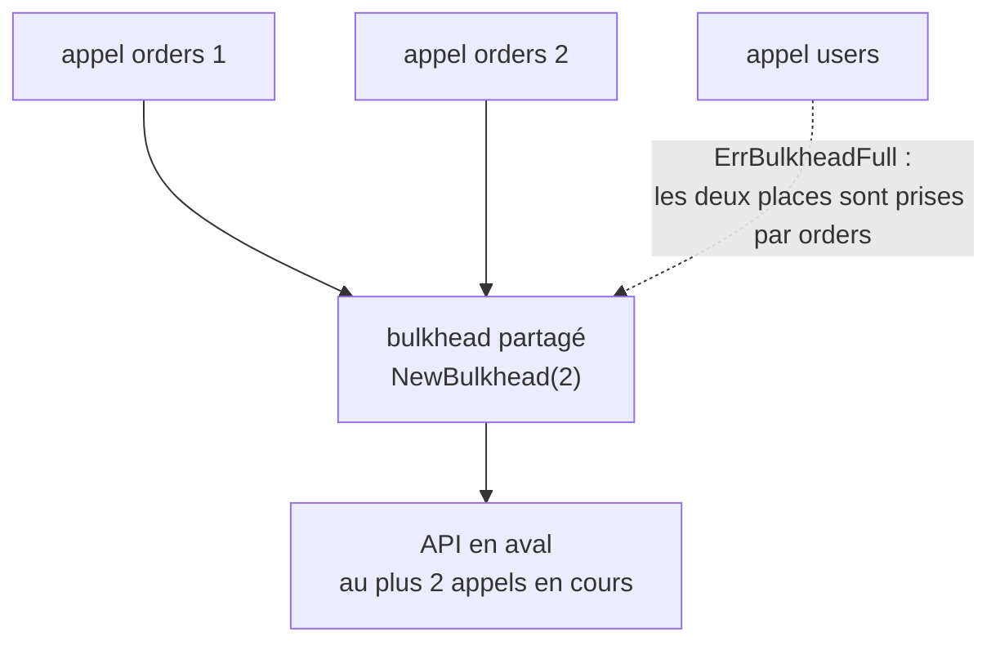

*[Read in English](README.md)*

# Exemple 53 — Partager un bulkhead entre policies

Montre `WithSharedBulkhead` : plusieurs policies partagent un même bulkhead, et
la limite d'appels en cours vaut pour toutes à la fois.

## Ce qu'il démontre

Une API en aval accepte un nombre fixe d'appels simultanés, quelle que soit la
route utilisée. Chaque route a sa propre policy. Un `WithBulkhead` par policy
limite chaque route séparément : deux routes avec chacune un bulkhead de 2
peuvent encore envoyer 4 appels en même temps.

`WithSharedBulkhead` rattache un seul `Bulkhead`, créé avec `NewBulkhead`, à
chaque policy. Le nombre d'appels en cours, toutes policies confondues, ne
dépasse pas sa capacité. Un appel sur une route peut donc être refusé à cause
des appels d'une autre route.

L'exemple partage `NewBulkhead(2, ...)` entre une policy `orders` et une policy
`users` :

- **Deux appels orders prennent les deux places.** Chacun attend sur un channel
  à l'intérieur du bulkhead, et l'exemple attend que les deux y soient entrés.
  Les deux policies affichent `BulkheadInUse` = 2 sur 2 : leurs jauges décrivent
  le même bulkhead.
- **Un appel users est refusé.** La policy users n'a encore fait aucun appel,
  mais le bulkhead est plein : l'appel échoue tout de suite avec
  `ErrBulkheadFull`, et sa fonction ne tourne pas. Le refus compte dans la
  policy users (`BulkheadRejected` = 1, son hook `OnBulkheadFull` se déclenche
  une fois), et pas dans la policy orders, dont les appels ont rempli le
  bulkhead.
- **Les appels orders se terminent.** L'exemple ferme le channel et attend le
  retour des deux appels. Les places sont de nouveau libres, et l'appel users
  suivant passe.

## Fonctionnement



## Concepts clés

| Concept | Détail |
|---|---|
| `NewBulkhead(n, clock, hooks, opts...)` | Crée le bulkhead à partager. Ses options (attente maximale, profondeur de file, CoDel) valent pour toutes les policies |
| `WithSharedBulkhead(bh)` | Le rattache à une policy. Il occupe la même place dans la chaîne que `WithBulkhead` : une place couvre tout l'appel, retries et backoff compris |
| Limite commune | Au plus `n` appels en cours sur l'ensemble des policies qui le partagent |
| Hooks et compteurs | Chaque policy rapporte ses propres appels : les événements vont aux hooks et aux compteurs de cette policy, pas aux hooks passés à `NewBulkhead` |
| Jauges | `BulkheadInUse`, `BulkheadCap`, `BulkheadQueued` et `CoDelLoad` décrivent le même bulkhead dans chaque policy : agrégez-les avec max, pas avec sum |
| Horloge | Le bulkhead partagé garde l'horloge passée à `NewBulkhead`. Le `WithClock` d'une policy ne la remplace pas |
| Pas réentrant | Une opération lancée par une policy rattachée au bulkhead partagé ne doit appeler, ni directement ni indirectement, aucune policy rattachée au même bulkhead, la policy appelante comprise : l'appel interne a besoin d'une deuxième place pendant que l'appel externe en tient une. Sous la capacité, l'appel interne obtient encore une place : le défaut n'apparaît qu'en charge |
| Exclusions | Il ne se combine ni avec `WithBulkhead` ni avec `WithAdaptiveConcurrency` (`NewPolicy` panique avec `ErrSharedBulkheadConflict`). Réglez-le avec `Bulkhead.Reconfigure`, pas avec `Policy.Reconfigure`. Code uniquement |

## Quand l'utiliser

- Avec plusieurs routes d'une même API en aval, chacune avec sa propre policy,
  sous une seule limite de concurrence de cette API.
- Gardez `WithBulkhead` quand chaque policy a sa propre limite.

## Lancer

```bash
go run ./examples/53-shared-bulkhead/
```

## Sortie attendue

```text
=== Two orders calls hold both slots ===
  orders: in use=2/2
  users:  in use=2/2 (the same bulkhead)

=== A users call while orders holds the slots ===
  users call: result="" err=bulkhead full bulkhead full=true fn ran=false
  users:  rejected=1 OnBulkheadFull=1
  orders: rejected=0

=== The orders calls end ===
  in use=0/2
  users call: result="user 42" err=<nil> bulkhead full=false fn ran=true
```
