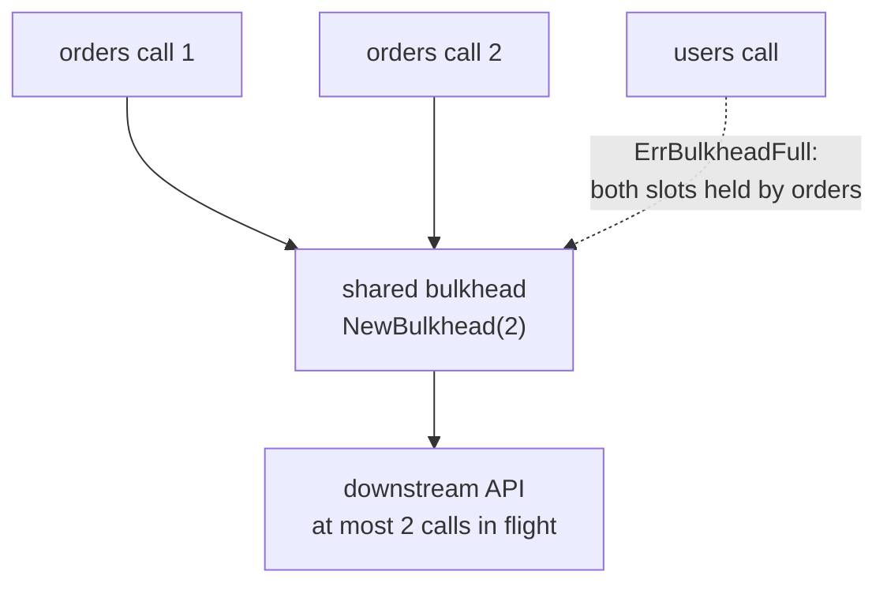

*[Lire en Français](README.fr.md)*

# Example 53 — Share One Bulkhead Across Policies

Demonstrates `WithSharedBulkhead`: several policies share one bulkhead, so the
cap on calls in flight holds across all of them.

## What it demonstrates

A downstream API accepts a fixed number of concurrent calls, whatever route
they use. Each route has its own policy. A `WithBulkhead` per policy caps each
route on its own: two routes with a bulkhead of 2 each can still send 4 calls
at once.

`WithSharedBulkhead` attaches one `Bulkhead`, built with `NewBulkhead`, to
every policy. At most its capacity of calls are in flight across all of them,
so a call on one route can be refused because of the calls on another.

The example shares `NewBulkhead(2, ...)` between an `orders` policy and a
`users` policy:

- **Two orders calls hold both slots.** Each one waits inside the bulkhead on a
  channel, and the example waits until both are inside. Both policies report
  `BulkheadInUse` = 2 out of 2: their gauges describe the same bulkhead.
- **A users call is refused.** The users policy has made no call yet, but the
  bulkhead is full: the call fails at once with `ErrBulkheadFull`, and its
  function does not run. The rejection counts in the users policy
  (`BulkheadRejected` = 1, its `OnBulkheadFull` hook fires once), not in the
  orders policy, whose calls filled the bulkhead.
- **The orders calls end.** The example closes the channel and waits for both
  calls to return. The slots are free again, and the next users call goes
  through.

## How it works



## Key concepts

| Concept | Detail |
|---|---|
| `NewBulkhead(n, clock, hooks, opts...)` | Builds the bulkhead to share. Its options (max wait, queue depth, CoDel) apply to every policy |
| `WithSharedBulkhead(bh)` | Attaches it to a policy. It takes the same place in the chain as `WithBulkhead`, so a slot covers the whole call, retries and backoff included |
| Combined cap | At most `n` calls are in flight across every sharing policy |
| Hooks and counters | Each policy reports its own calls: the events go to that policy's hooks and counters, not to the hooks passed to `NewBulkhead` |
| Gauges | `BulkheadInUse`, `BulkheadCap`, `BulkheadQueued` and `CoDelLoad` describe the same bulkhead in every policy: aggregate them with max, not sum |
| Clock | The shared bulkhead keeps the clock passed to `NewBulkhead`. A policy's `WithClock` does not replace it |
| Not re-entrant | An operation run through a policy attached to the shared bulkhead must not call, directly or indirectly, any policy attached to the same bulkhead, the calling policy included: the inner call needs a second slot while the outer call holds one. Below capacity the inner call still gets a slot, so the fault shows only under load |
| Exclusions | It cannot be combined with `WithBulkhead` or `WithAdaptiveConcurrency` (`NewPolicy` panics with `ErrSharedBulkheadConflict`). Retune it with `Bulkhead.Reconfigure`, not `Policy.Reconfigure`. Code-only |

## When to use

- Several routes of one downstream, each with its own policy, under one
  concurrency limit of that downstream.
- Keep `WithBulkhead` when each policy has a limit of its own.

## Run

```bash
go run ./examples/53-shared-bulkhead/
```

## Expected output

```text
=== Two orders calls hold both slots ===
  orders: in use=2/2
  users:  in use=2/2 (the same bulkhead)

=== A users call while orders holds the slots ===
  users call: result="" err=bulkhead full bulkhead full=true fn ran=false
  users:  rejected=1 OnBulkheadFull=1
  orders: rejected=0

=== The orders calls end ===
  in use=0/2
  users call: result="user 42" err=<nil> bulkhead full=false fn ran=true
```
