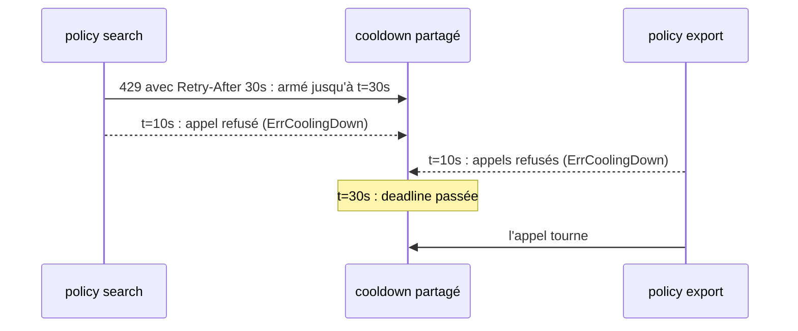

*[Read in English](README.md)*

# Exemple 54 — Cooldown partagé

Montre un cooldown partagé par deux policies : après un Retry-After, les
deux refusent les appels en local jusqu'à la deadline donnée par le serveur.

## Ce qu'il démontre

Après un 429 avec un long `Retry-After`, chaque appel qui part encore, sur
cette route ou sur une autre sous le même quota, reçoit son propre 429.
`NewCooldown` crée un cooldown, et `WithSharedCooldown` le rattache à chaque
policy sous ce quota. Tout appel en échec dont l'erreur porte un
`RetryAfterProvider`, par exemple `r8e.RetryAfterError(err, d)`, l'arme
jusqu'à maintenant plus son délai. Tant qu'il est armé, un appel sur
n'importe quelle policy qui le partage échoue tout de suite avec
`ErrCoolingDown`, et sa fonction ne tourne pas.

L'exemple partage un cooldown entre une policy `search` et une policy
`export`. Une horloge manuelle, passée avec `CooldownClock`, fait avancer le
temps sans aucune attente réelle :

- **search reçoit un 429 avec `Retry-After: 30s`.** Sa fonction renvoie
  `r8e.RetryAfterError(errQuota, 30*time.Second)`. L'appelant reçoit cette
  erreur, et le cooldown est armé pour 30 secondes : `OnCooldownArmed(30s)` se
  déclenche sur la policy search.
- **Les appels des deux routes sont refusés tout de suite.** Dix secondes plus tard, un
  appel search et deux appels export échouent avec `ErrCoolingDown`, et
  aucune de leurs fonctions ne tourne. Chaque policy compte ses propres refus
  dans la métrique `CoolingDown` (1 pour search, 2 pour export), et la policy
  export, qui n'a jamais reçu de 429, affiche l'état de santé `cooling_down`.
- **La deadline passe.** Vingt secondes plus tard, le cooldown n'est plus
  armé. L'appel export suivant tourne et réussit.

## Fonctionnement



## Concepts clés

| Concept | Détail |
|---|---|
| `NewCooldown(opts...)` | Crée un cooldown, désarmé. `MaxCooldown(d)` plafonne un délai (une heure par défaut), `CooldownIf(fn)` restreint les erreurs qui l'arment, `CooldownClock(c)` fixe son horloge |
| `WithSharedCooldown(cd)` | Rattache le cooldown à une policy : le Retry-After d'un serveur arrête alors les appels de toutes les policies qui le partagent. Code uniquement |
| Armement | Tout appel en échec dont l'erreur porte un `RetryAfterProvider` l'arme jusqu'à maintenant plus son délai, dans la limite de `MaxCooldown`. Un délai plus tardif ne fait que repousser la deadline, et un succès ne désarme pas le cooldown |
| Refus | Tant qu'il est armé, un appel échoue tout de suite avec `ErrCoolingDown` et aucune tentative ne part. `IsLocalRejection` le reconnaît |
| Hooks et métrique | `OnCooldownArmed(d)` quand un délai l'arme ou le prolonge, `OnCoolingDown()` pour un appel refusé, compté dans `CoolingDown`. Chaque policy rapporte ses propres refus et armements |
| Santé | Un cooldown armé rend la policy dégradée (`cooling_down`), jamais critique |
| Horloge | Un cooldown créé avec `NewCooldown` lit l'horloge passée avec `CooldownClock`, `RealClock` par défaut. `WithCooldown` lit plutôt l'horloge de la policy |
| Exclusion | `WithSharedCooldown` ne se combine pas avec `WithCooldown` (`NewPolicy` panique avec `ErrSharedCooldownConflict`) |

## Quand l'utiliser

- Avec plusieurs routes sous un même quota serveur, qui répond 429 avec
  `Retry-After`.
- Pour une seule policy, utilisez plutôt `WithCooldown`.

## Lancer

```bash
go run ./examples/54-cooldown/
```

## Sortie attendue

```text
=== search gets a 429 with Retry-After: 30s ===
  search: OnCooldownArmed(30s)
  search call: fn ran=true result="" err=429 too many requests cooling down=false
  cooldown armed=true remaining=30s

=== Both routes are refused at once ===
  search call: fn ran=false result="" err=cooling down cooling down=true
  export call: fn ran=false result="" err=cooling down cooling down=true
  export call: fn ran=false result="" err=cooling down cooling down=true
  CoolingDown metric: search=1 export=2
  export health: cooling_down

=== The deadline passes ===
  cooldown armed=false remaining=0s
  export call: fn ran=true result="export result" err=<nil> cooling down=false
```
