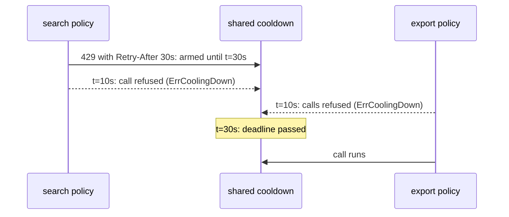

*[Lire en Français](README.fr.md)*

# Example 54 — Shared Cooldown

Demonstrates a cooldown shared by two policies: after a Retry-After hint, both
refuse calls locally until the deadline the server gave.

## What it demonstrates

After a 429 with a long `Retry-After`, every call that still goes out, on this
route or on any other under the same quota, gets its own 429. `NewCooldown`
builds one cooldown, and `WithSharedCooldown` attaches it to every policy under
the quota. Any failed call whose error carries a `RetryAfterProvider`, such as
`r8e.RetryAfterError(err, d)`, arms it until now plus the hint. While it is
armed, a call on any sharing policy fails at once with `ErrCoolingDown`, and
its function does not run.

The example shares one cooldown between a `search` policy and an `export`
policy. A manual clock, passed through `CooldownClock`, moves time forward
without any real wait:

- **search gets a 429 with `Retry-After: 30s`.** Its function returns
  `r8e.RetryAfterError(errQuota, 30*time.Second)`. The caller gets that error,
  and the cooldown is armed for 30 seconds: `OnCooldownArmed(30s)` fires on the
  search policy.
- **Both routes are refused at once.** Ten seconds later, one search call and
  two export calls fail with `ErrCoolingDown`, and none of their functions
  runs. Each policy counts its own refusals in the `CoolingDown` metric
  (search 1, export 2), and the export policy, which never got a 429, reports
  the `cooling_down` health state.
- **The deadline passes.** Twenty seconds more, and the cooldown is no longer
  armed. The next export call runs and succeeds.

## How it works



## Key concepts

| Concept | Detail |
|---|---|
| `NewCooldown(opts...)` | Builds a cooldown, disarmed. `MaxCooldown(d)` caps one hint (default one hour), `CooldownIf(fn)` narrows which errors arm it, `CooldownClock(c)` sets its clock |
| `WithSharedCooldown(cd)` | Attaches the cooldown to a policy, so one server's Retry-After stops the calls of every sharing policy. Code-only |
| Arming | Any failed call whose error carries a `RetryAfterProvider` arms it until now plus the hint, capped by `MaxCooldown`. A later hint only extends the deadline, and a success does not disarm it |
| Refusal | While armed, a call fails at once with `ErrCoolingDown` and no attempt leaves. `IsLocalRejection` recognises it |
| Hooks and metric | `OnCooldownArmed(d)` when a hint arms or extends it, `OnCoolingDown()` for a refused call, counted in `CoolingDown`. Each policy reports its own refusals and arms |
| Health | An armed cooldown makes the policy degraded (`cooling_down`), never critical |
| Clock | A cooldown built with `NewCooldown` reads the clock given with `CooldownClock`, `RealClock` by default. `WithCooldown` reads the policy's clock instead |
| Exclusion | `WithSharedCooldown` cannot be combined with `WithCooldown` (`NewPolicy` panics with `ErrSharedCooldownConflict`) |

## When to use

- Several routes under one server quota that answers 429 with `Retry-After`.
- Use `WithCooldown` instead for a single policy.

## Run

```bash
go run ./examples/54-cooldown/
```

## Expected output

```text
=== search gets a 429 with Retry-After: 30s ===
  search: OnCooldownArmed(30s)
  search call: fn ran=true result="" err=429 too many requests cooling down=false
  cooldown armed=true remaining=30s

=== Both routes are refused at once ===
  search call: fn ran=false result="" err=cooling down cooling down=true
  export call: fn ran=false result="" err=cooling down cooling down=true
  export call: fn ran=false result="" err=cooling down cooling down=true
  CoolingDown metric: search=1 export=2
  export health: cooling_down

=== The deadline passes ===
  cooldown armed=false remaining=0s
  export call: fn ran=true result="export result" err=<nil> cooling down=false
```
