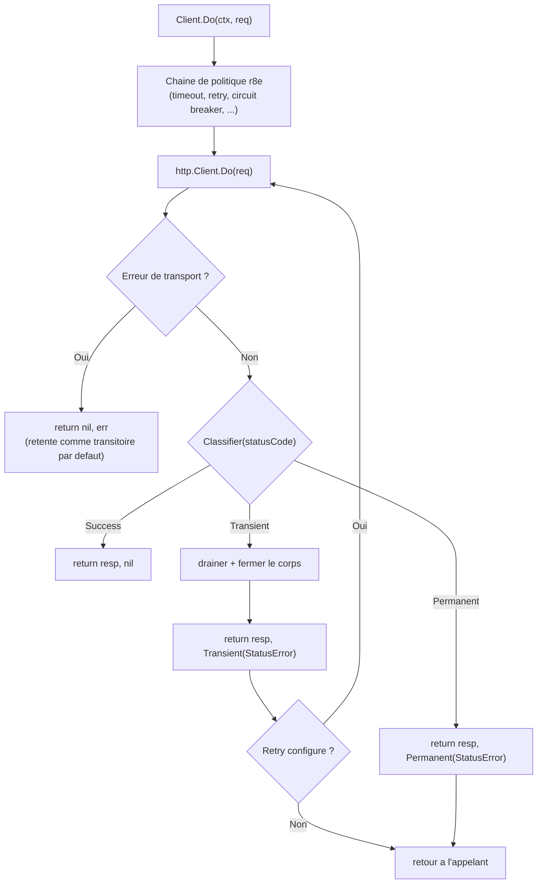

*[Read in English](README.md)*

# httpx — Adaptateur HTTP Client Resilient

Adaptateur leger qui enveloppe un `http.Client` standard avec une politique de
resilience r8e et un classificateur de codes de statut HTTP fourni par
l'utilisateur.

## Ce qu'il fait

- Enveloppe n'importe quel `*http.Client` avec retry, timeout, circuit breaker
  et tous les autres patrons r8e dans un seul `Client` reutilisable.
- Permet de definir quels codes de statut HTTP sont **transitoires**
  (retentables) ou **permanents** (non retentables) via une fonction
  `Classifier`.
- Retourne a la fois le `*http.Response` et l'erreur en cas d'echec, comme
  `http.Client.Do` — l'appelant garde le controle total de la reponse.
- Draine et ferme automatiquement le corps de la reponse sur les erreurs
  transitoires afin que les connexions TCP soient reutilisees lors des
  tentatives.
- Rejoue le corps de la requete a chaque tentative via `req.GetBody`, afin
  qu'une requete `POST`/`PUT` retentee renvoie correctement son corps (un corps
  sans `GetBody` n'est pas rejouable).

## Concepts cles

| Concept | Detail |
|---|---|
| `Client` | Enveloppe `http.Client` + `r8e.Policy` + `Classifier` |
| `NewClient` | Constructeur — passer un nom, un client HTTP, un classificateur et des options r8e |
| `Client.Do` | Execute `*http.Request` a travers la politique de resilience |
| `Classifier` | `func(statusCode int) ErrorClass` — associe les codes de statut aux classes d'erreur |
| `NewResponseClient` / `ResponseClassifier` | `func(resp *http.Response, body []byte) error` — classe à partir du statut, des en-têtes et du corps |
| `ErrorClass` | Enum : `Success`, `Transient`, `Permanent` |
| `StatusError` | Type d'erreur portant le `*http.Response` original pour inspection (ajouté par `NewClient` ; un `ResponseClassifier` le renvoie lui-même) |

## Flux de requete



## Utilisation

```go
package main

import (
    "context"
    "errors"
    "net/http"
    "time"

    "github.com/byte4ever/r8e"
    "github.com/byte4ever/r8e/httpx"
)

func main() {
    // Definir quels codes sont transitoires vs permanents.
    classifier := func(code int) httpx.ErrorClass {
        switch {
        case code >= 200 && code < 300:
            return httpx.Success
        case code == 429, code == 502, code == 503, code == 504:
            return httpx.Transient
        default:
            return httpx.Permanent
        }
    }

    // Creer un client HTTP resilient.
    client := httpx.NewClient("payment-api",
        http.DefaultClient,
        classifier,
        r8e.WithTimeout(2*time.Second),
        r8e.WithRetry(3, r8e.ExponentialBackoff(100*time.Millisecond)),
        r8e.WithCircuitBreaker(),
    )

    // Utiliser comme http.Client.Do.
    ctx := context.Background()
    req, _ := http.NewRequestWithContext(ctx, http.MethodGet,
        "https://api.example.com/pay", nil)

    resp, err := client.Do(ctx, req)
    if err != nil {
        // Extraire le StatusError pour inspecter la reponse.
        var statusErr *httpx.StatusError
        if errors.As(err, &statusErr) {
            _ = statusErr.Response   // reponse originale
            _ = statusErr.StatusCode // ex. 503
        }
        return
    }
    defer resp.Body.Close()

    // resp.StatusCode est 2xx ici.
}
```

## Gestion des erreurs

Avec `NewClient`, sur les chemins d'erreur, le `*http.Response` est accessible via
`errors.As` (avec `NewResponseClient`, seulement si le classifier renvoie un
`StatusError`) :

```go
var statusErr *httpx.StatusError
if errors.As(err, &statusErr) {
    // statusErr.Response — reponse HTTP originale
    // statusErr.StatusCode — le code de statut qui a declenche l'erreur
}
```

| Scenario | `resp` | `err` | `StatusError` |
|---|---|---|---|
| 2xx (Success) | non-nil | `nil` | n/a |
| Transitoire (ex. 503) | non-nil | `Transient` | extractible |
| Permanent (ex. 400) | non-nil | `Permanent` | extractible |
| Tentatives epuisees | `nil` | `ErrRetriesExhausted` | extractible (derniere tentative) |
| Erreur de transport | `nil` | erreur de transport | absent |

## Classer à partir du corps (`ResponseClassifier`)

Certaines API renvoient le même statut pour deux cas opposés, et seul le corps
les distingue : un 403 pour un jeton à renouveler ou pour une ressource
déplacée, un 404 pour un objet inconnu ou pour une route absente pendant un
déploiement. `NewResponseClient` prend un `ResponseClassifier` à la place d'un
`Classifier` :

```go
classify := func(resp *http.Response, body []byte) error {
    statusErr := &httpx.StatusError{Response: resp, StatusCode: resp.StatusCode}

    switch {
    case resp.StatusCode < 300:
        return nil
    case resp.StatusCode == http.StatusForbidden && bytes.Contains(body, []byte("token_expired")):
        return errTokenExpired // transitoire : retenté
    case resp.StatusCode == http.StatusTooManyRequests || resp.StatusCode >= 500:
        return statusErr // transitoire, et Retry-After est respecté
    default:
        return r8e.Permanent(statusErr)
    }
}

client := httpx.NewResponseClient("orders", http.DefaultClient, classify,
    r8e.WithTimeout(2*time.Second),
    r8e.WithRetry(3, r8e.ExponentialBackoff(100*time.Millisecond)),
)
```

- Le classifier renvoie `nil` pour un succès, ou l'erreur qui fait échouer la
  tentative. Cette erreur est classée comme partout dans r8e :
  `r8e.Permanent(err)` arrête le retry, `r8e.RetryAfterError(err, d)` porte un
  délai, et toute autre erreur est transitoire.
- `Do` renvoie cette erreur telle quelle. Contrairement à `NewClient`, ce chemin
  n'ajoute pas de `StatusError` et ne lit pas l'en-tête `Retry-After`. Pour
  retrouver les deux, renvoyez
  `&httpx.StatusError{Response: resp, StatusCode: resp.StatusCode}`, comme dans
  l'exemple.
- Pour un statut de 300 ou plus, `body` contient les `httpx.MaxClassifiedBody`
  premiers octets (64 Kio), et l'appelant relit tout le corps depuis le début.
- En dessous de 300, `body` vaut `nil` et le corps n'est pas lu : un succès en
  streaming ou une connexion upgradée (101) reste telle quelle.
- `body` est la seule vue du classifier sur le corps : pendant l'appel,
  `resp.Body` vaut `http.NoBody`, et le classifier ne peut pas consommer le
  corps que reçoit l'appelant.
- Quand l'erreur n'est pas permanente, un retry peut suivre : le corps est vidé
  puis fermé pour réutiliser la connexion. Une erreur permanente, ou `nil`,
  laisse le corps lisible.
- Un échec de lecture du corps est transitoire, et le classifier n'est pas
  appelé.

`NewClient` et son `Classifier` ne changent pas.

## Propagation de deadline

gRPC propage une deadline à travers une frontière de service automatiquement ; le
HTTP simple, non. `httpx` fournit les deux moitiés pour qu'un budget de temps r8e
voyage sur le fil sous forme d'un header relatif insensible au clock-skew
(`X-R8e-Timeout-Ms`, à l'image du `grpc-timeout` de gRPC) :

| Helper | Rôle | Détail |
|---|---|---|
| `InjectDeadline(req, clock)` | **Egress** | Écrit le budget restant du contexte de `req` en header ms relatif. Renvoie `false` si le contexte n'a pas de deadline. Plancher à 1ms pour un budget épuisé afin qu'il se propage quand même. |
| `ExtractDeadline(ctx, req)` | **Ingress** | Reconstruit `now + restant` depuis le header en contexte borné (et `cancel`). Renvoie le parent inchangé pour un header absent, invalide ou non positif ; plafonne une valeur débordante. |

```go
// Appelant (egress) : transforme le budget de la policy en vraie ctx.Deadline,
// puis inscrit le temps restant sur la requête sortante.
req, _ := http.NewRequestWithContext(ctx, http.MethodGet, url, http.NoBody)
httpx.InjectDeadline(req, r8e.RealClock{})

// Appelé (ingress) : adopte la deadline de l'appelant, puis exécute le travail
// sous un budget resserré à celle-ci.
ctx, cancel := httpx.ExtractDeadline(r.Context(), r)
defer cancel()
policy := r8e.NewPolicy[T]("svc",
    r8e.WithRetry(5, r8e.ConstantBackoff(50*time.Millisecond)),
    r8e.WithTimeBudget(10*time.Second, r8e.RespectInboundDeadline()),
)
```

Associez `InjectDeadline` à `r8e.PropagateDeadline()` côté appelant et
`ExtractDeadline` à `r8e.RespectInboundDeadline()` côté appelé pour une chaîne
cross-service complète. Voir
[`examples/43-deadline-propagation-cross-service`](../examples/43-deadline-propagation-cross-service).

## Installation

```bash
go get github.com/byte4ever/r8e
```

Le package `httpx` fait partie du module r8e — aucune installation separee
n'est necessaire.
