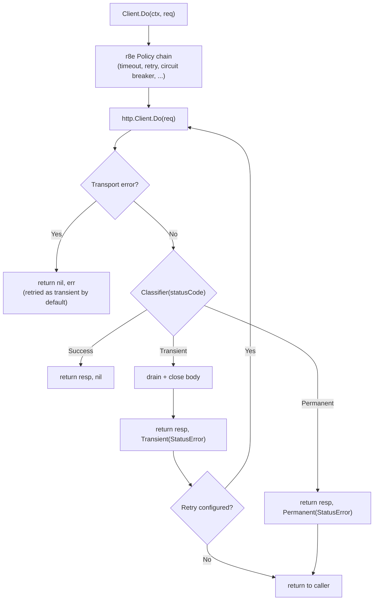

*[Lire en Francais](README.fr.md)*

# httpx — Resilient HTTP Client Adapter

Thin adapter that wraps a standard `http.Client` with an r8e resilience policy
and a user-provided HTTP status code classifier.

## What it does

- Wraps any `*http.Client` with retry, timeout, circuit breaker, and all other
  r8e patterns in a single reusable `Client`.
- Lets you define which HTTP status codes are **transient** (retriable) or
  **permanent** (non-retriable) via a `Classifier` function.
- Returns both the `*http.Response` and the error on failure, just like
  `http.Client.Do` — the caller stays in full control of the response.
- Drains and closes the response body automatically on transient errors so TCP
  connections are reused during retries.
- Replays the request body on each retry via `req.GetBody`, so a retried
  `POST`/`PUT` resends its body correctly (a body without `GetBody` is not
  replayable).

## Key concepts

| Concept | Detail |
|---|---|
| `Client` | Wraps `http.Client` + `r8e.Policy` + `Classifier` |
| `NewClient` | Constructor — pass a name, HTTP client, classifier, and r8e options |
| `Client.Do` | Executes `*http.Request` through the resilience policy |
| `Classifier` | `func(statusCode int) ErrorClass` — maps status codes to error classes |
| `NewResponseClient` / `ResponseClassifier` | `func(resp *http.Response, body []byte) error` — classifies from the status, headers and body |
| `ErrorClass` | Enum: `Success`, `Transient`, `Permanent` |
| `StatusError` | Error type carrying the original `*http.Response` for inspection |

## Request flow



## Usage

```go
package main

import (
    "context"
    "errors"
    "net/http"
    "time"

    "github.com/byte4ever/r8e"
    "github.com/byte4ever/r8e/httpx"
)

func main() {
    // Define which status codes are transient vs permanent.
    classifier := func(code int) httpx.ErrorClass {
        switch {
        case code >= 200 && code < 300:
            return httpx.Success
        case code == 429, code == 502, code == 503, code == 504:
            return httpx.Transient
        default:
            return httpx.Permanent
        }
    }

    // Create a resilient HTTP client.
    client := httpx.NewClient("payment-api",
        http.DefaultClient,
        classifier,
        r8e.WithTimeout(2*time.Second),
        r8e.WithRetry(3, r8e.ExponentialBackoff(100*time.Millisecond)),
        r8e.WithCircuitBreaker(),
    )

    // Use it like http.Client.Do.
    ctx := context.Background()
    req, _ := http.NewRequestWithContext(ctx, http.MethodGet,
        "https://api.example.com/pay", nil)

    resp, err := client.Do(ctx, req)
    if err != nil {
        // Extract the StatusError to inspect the response.
        var statusErr *httpx.StatusError
        if errors.As(err, &statusErr) {
            _ = statusErr.Response   // original response
            _ = statusErr.StatusCode // e.g. 503
        }
        return
    }
    defer resp.Body.Close()

    // resp.StatusCode is 2xx here.
}
```

## Error handling

On error paths, the `*http.Response` is accessible via `errors.As`:

```go
var statusErr *httpx.StatusError
if errors.As(err, &statusErr) {
    // statusErr.Response — original HTTP response
    // statusErr.StatusCode — the status code that triggered the error
}
```

| Scenario | `resp` | `err` | `StatusError` |
|---|---|---|---|
| 2xx (Success) | non-nil | `nil` | n/a |
| Transient (e.g. 503) | non-nil | `Transient` | extractable |
| Permanent (e.g. 400) | non-nil | `Permanent` | extractable |
| Retries exhausted | `nil` | `ErrRetriesExhausted` | extractable (last attempt) |
| Transport error | `nil` | transport error | not present |

## Classifying from the body (`ResponseClassifier`)

Some APIs answer the same status for opposite cases, and only the body tells
them apart: a 403 for a token to renew or for a resource that moved, a 404 for
an unknown object or for a route missing during a rollout. `NewResponseClient`
takes a `ResponseClassifier` instead of a `Classifier`:

```go
classify := func(resp *http.Response, body []byte) error {
    switch {
    case resp.StatusCode/100 == 2:
        return nil
    case resp.StatusCode == http.StatusForbidden && bytes.Contains(body, []byte("token_expired")):
        return errTokenExpired // transient: retried
    default:
        return r8e.Permanent(fmt.Errorf("status %d", resp.StatusCode))
    }
}

client := httpx.NewResponseClient("orders", http.DefaultClient, classify,
    r8e.WithTimeout(2*time.Second),
    r8e.WithRetry(3, r8e.ExponentialBackoff(100*time.Millisecond)),
)
```

- The classifier returns `nil` for a success, or the error the attempt fails
  with. That error is classified as anywhere in r8e: `r8e.Permanent(err)` stops
  the retry, `r8e.RetryAfterError(err, d)` carries a delay hint, and any other
  error is transient.
- For a non-2xx response, `body` holds the first `httpx.MaxClassifiedBody`
  bytes (64 KiB), and `resp.Body` still reads the whole body from the start.
- For a 2xx response, `body` is `nil` and the body is not read, so a streamed
  success stays streamed.
- When the error is not permanent, a retry may follow: the body is drained and
  closed so the connection is reused. A permanent error, or `nil`, leaves the
  body readable.
- A failure reading the body is transient, and the classifier is not called.

`NewClient` and its `Classifier` are unchanged.

## Deadline propagation

gRPC propagates a deadline across a service boundary automatically; plain HTTP
does not. `httpx` ships the two halves so an r8e time budget can travel the wire
as a relative, clock-skew-safe header (`X-R8e-Timeout-Ms`, mirroring gRPC's
`grpc-timeout`):

| Helper | Role | Detail |
|---|---|---|
| `InjectDeadline(req, clock)` | **Egress** | Writes the remaining budget of `req`'s context as a relative ms header. Reports `false` when the context has no deadline. Floors a spent budget to 1ms so it still propagates. |
| `ExtractDeadline(ctx, req)` | **Ingress** | Reconstructs `now + remaining` from the header into a bounded context (and `cancel`). Returns the parent unchanged for an absent, invalid, or non-positive header; clamps an overflowing value. |

```go
// Caller (egress): turn the policy's budget into a real ctx.Deadline, then
// stamp the remaining time onto the outgoing request.
req, _ := http.NewRequestWithContext(ctx, http.MethodGet, url, http.NoBody)
httpx.InjectDeadline(req, r8e.RealClock{})

// Callee (ingress): adopt the caller's deadline, then run work under a budget
// tightened to it.
ctx, cancel := httpx.ExtractDeadline(r.Context(), r)
defer cancel()
policy := r8e.NewPolicy[T]("svc",
    r8e.WithRetry(5, r8e.ConstantBackoff(50*time.Millisecond)),
    r8e.WithTimeBudget(10*time.Second, r8e.RespectInboundDeadline()),
)
```

Pair `InjectDeadline` with `r8e.PropagateDeadline()` on the caller and
`ExtractDeadline` with `r8e.RespectInboundDeadline()` on the callee for a full
cross-service chain. See
[`examples/43-deadline-propagation-cross-service`](../examples/43-deadline-propagation-cross-service).

## Install

```bash
go get github.com/byte4ever/r8e
```

The `httpx` package is part of the r8e module — no separate install needed.
